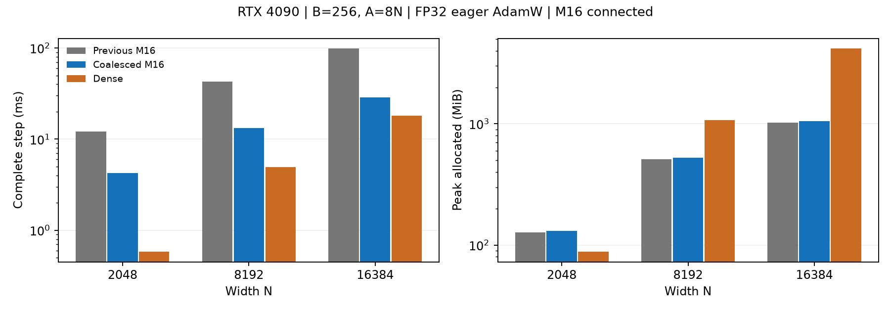

# Connected M16の行連続配置の結果（2026-11-09）

[English](connected-m16-coalesced-results-20261109.md) | **日本語**

この条件では行を連続配置することで、直前のowner方式に対し完全eager stepが
2.86～3.45倍速くなった。N8192は13.208ms、Denseは4.920msで2.68倍遅く、
N16384は28.621ms、Denseは17.984msで1.59倍遅い。次の短期学習評価に進める候補だが、
実際のLM統合、学習品質、LM全体の速度は未測定。
ベンチマーク限定の選択肢であり、本番dispatcherや既定設定は変更しない。

## 同条件の完全step

RTX4090 24564MiB・CC8.9、Torch2.9.1+cu128、CUDA12.8、Triton3.5.1。
B256、A8N、正方形chart、IEEE FP32（TF32無効）、warmup5回、計測15回。
forward、MSE、dXを含むbackward、fused AdamW、物理半径・中心の復元まで含む。
geometry生成、転置、再計算も時間に含み、コンパイルと独立検証は除外する。
Denseは標準nn.Linear初期化を用いる速度・メモリ対照で、同じ初期関数ではない。

| N | 直前のM16 ms | 行連続M16 ms | Dense ms | 新方式 / Dense |
|---|---:|---:|---:|---:|
| 2048 | 12.195 | 4.263 | 0.582 | 7.33倍 |
| 8192 | 42.827 | 13.208 | 4.920 | 2.68倍 |
| 16384 | 98.850 | 28.621 | 17.984 | 1.59倍 |

N8192を新しいworkerで独立に再実行し、直前42.757ms、新方式13.194ms、
Dense4.910msを得た。N8192は2実行、N2048/N16384は各1実行。
N2048のDense標本は0.473～1.029msで、中央値から微細な差を断定したり、
異なる形状・GPUへ外挿したりしない。

| N | 直前 allocated / reserved MiB | 新方式 allocated / reserved MiB | Dense allocated / reserved MiB |
|---|---:|---:|---:|
| 2048 | 127.185 / 146 | 131.185 / 146 | 88.252 / 110 |
| 8192 | 509.503 / 580 | 525.503 / 560 | 1072.252 / 1342 |
| 16384 | 1019.003 / 1146 | 1051.003 / 1122 | 4176.252 / 5190 |

常駐model、勾配、AdamW、一時領域を含むallocatorの実測ピークであり、
GPUプロセス全体の使用量ではない。転置でallocatedは直前より約3%増加した。
Denseに対する新方式のallocatedはN8192で49.0%、N16384で25.2%。
N2048ではDenseより大きい。



## 高速化の内容と確認範囲

直前は応答とパラメータ勾配のCTAが大きなstrideで異なる行を読んでいた。
`[site,row]`と`[node,feature,row]`に変更し、隣接laneが隣接行を読み、
CTA内でAtomのgeometryを共有する。warp集約とdX用の応答再利用で重複計算も減らす。
これらをまとめて計測したため、各変更単独の寄与は切り分けていない。
数学的profileと境界微分は変更しない。

- 各計測幅で境界・広い半径・周期の重複像を含む20Atomsを独立FP64積分と比較。
  Y、dX、振幅・半径・両中心の勾配が、絶対誤差・相対L2とも3e-4のゲートを通過。
  最大観測値は絶対6.549e-7、相対2.203e-5。
- 4stepのAdamWのParameters、一次・二次moment、counterがfixtureのゲートを通過。
  小規模oracle条件の検証であり、長期学習軌跡の検証ではない。
- 全3幅の実規模B256/A8Nで検証済みownerと比較し、最大絶対7.630e-6、
  相対L2 1.340e-7。独立oracleを補完するが、全AのFP64証明ではない。
- GPU pytestは5件成功。行数1/7/65/256、非連続input/余接ベクトル、
  backwardのretain、複数forward、Parameter変更のversion guardを含む。
- ローカルCPU一式は2254成功、2645skip、警告19。GPUのskipはGPU検証に数えない。
  Plan/Case宣言チェックとRuffも成功。
- eager FP32の一次微分のみ。CUDA Graph/capture、高階微分、学習品質、
  他GPUは未検証。

## 再現と証拠保全

[手順](connected-m16-coalesced-20261109.ja.md)と
[集計JSON](connected-m16-coalesced-results-20261109.json)。
実行ソースは`132ab5b63510309f92c8ae9c76dfea84a5f08450`、
親は`bc1c3a8faa6172b55f16bba8b5c36819fc7492f0`（PR160）。

```bash
PYTHONPATH=src:. python -m pytest -q tests/test_connected_m16_coalesced.py
python -m benchmarks.cuda.linear.run \
  --plans benchmarks/cuda/linear/plans-connected-radius-coalesced.json \
  --case benchmarks/cuda/linear/cases/connected-radius-8192-r256-c8-coalesced.json \
  --polar-update radius --source-commit 132ab5b63510309f92c8ae9c76dfea84a5f08450 \
  --output output/connected-coalesced.json
```

Jobは`connected-m16-coalesced-4090-20261109-01`、driver PID22077で正常終了。
リモートrootは`/home/jovyan/work/srv21/cst-lab/connected-m16-coalesced-4090-20261109-01`。
ローカル生証拠はmain checkoutのignored `output/`配下の同名ディレクトリで、
driver、log、固定source、取得済みの完全結果、CPU logを含む。
リモートNFSとローカル取得物を両方保全し、以下のSHA256を照合済み。

- ソースarchive：`e833d13abd9c9be7b907b2d76197806715d0061cc2c4d48e0dce86cb90dc5779`。
- 結果archive：`876e77e43127f374ecd80f562cae8dfb959d769b4fc474094416c2aa125c68b5`。
- 記録されたsource file hashの5460比較がすべて固定archiveと一致。

終了後GPUは使用率0%・40MiBに戻った。Hubは起動を維持し、無関係なjob・dataは変更しない。
mergeとLM学習は行っていない。
