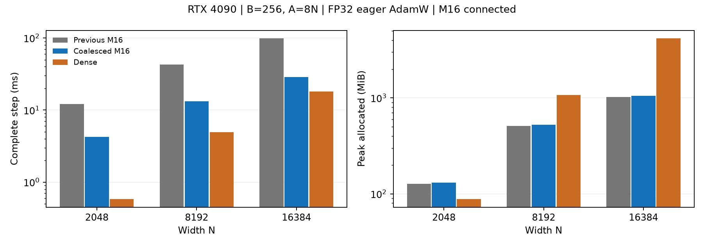

# Connected M16 contiguous-row results (2026-11-09)

**English** | [日本語](connected-m16-coalesced-results-20261109.ja.md)

Contiguous batch lanes reduce the complete eager step by 2.86–3.45x versus the
preceding owner schedule on this cohort. At N8192 the candidate takes 13.208 ms
versus Dense 4.920 ms (2.68x slower); at N16384 it takes 28.621 versus 17.984 ms
(1.59x slower). It is suitable for the next short learning evaluation, with actual
LM integration, learning quality and whole-LM throughput still unmeasured. This
is a benchmark-local opt-in, not a production dispatcher/default change.

## Matched complete steps

RTX 4090 24564 MiB / CC8.9, Torch 2.9.1+cu128, CUDA12.8, Triton3.5.1.
B256, A8N, square charts, IEEE FP32 (TF32 off), 5 warmups and 15 timed steps.
Complete eager forward, MSE, backward including dX, fused AdamW and physical
radius/center restoration. Geometry, transposes and recomputation are inside timing;
compilation and independent proofs are outside. Dense uses standard nn.Linear
initialization as a compute/memory control, not the same initial function.

| N | Previous M16 ms | Coalesced M16 ms | Dense ms | Candidate / Dense |
|---|---:|---:|---:|---:|
| 2048 | 12.195 | 4.263 | 0.582 | 7.33x |
| 8192 | 42.827 | 13.208 | 4.920 | 2.68x |
| 16384 | 98.850 | 28.621 | 17.984 | 1.59x |

An independent runner invocation with fresh workers at N8192 gave previous
42.757 ms, candidate 13.194 ms and Dense 4.910 ms. This is two runs at N8192 and
one each at N2048/N16384. N2048 Dense samples range 0.473–1.029 ms; do not infer
fine differences from its median or extrapolate to another shape/device.

| N | Previous allocated / reserved MiB | Candidate allocated / reserved MiB | Dense allocated / reserved MiB |
|---|---:|---:|---:|
| 2048 | 127.185 / 146 | 131.185 / 146 | 88.252 / 110 |
| 8192 | 509.503 / 580 | 525.503 / 560 | 1072.252 / 1342 |
| 16384 | 1019.003 / 1146 | 1051.003 / 1122 | 4176.252 / 5190 |

These are measured allocator peaks including resident model, gradients, AdamW and
temporaries, not total GPU process usage. Transposes increase allocated peak by
about 3% versus the previous schedule. Candidate allocated peak is 49.0% of Dense
at N8192 and 25.2% at N16384; it exceeds Dense at N2048.



## Why it is faster and what was checked

The previous projection and parameter-gradient CTA accessed different batch rows
with large strides. The new `[site,row]` and `[node,feature,row]` layouts let
neighboring lanes load neighboring rows; the CTA shares atom geometry. Warp
reductions and reuse of the already computed dX response remove redundant work.
These changes were measured together; their individual speed contributions have
not been isolated. The mathematical profile and boundary derivatives are unchanged.

- Independent FP64 quadrature, 20 boundary/wide/repeated-image atoms per measured
  width: Y, dX, amplitude/radius/both-center gradients pass max-absolute and
  relative-L2 gates of 3e-4. Maximum observed 6.549e-7 absolute and 2.203e-5 relative.
- Four-step AdamW Parameters, first/second moments and counters pass the fixture
  gates. This tests a small oracle cohort, not a long training trajectory.
- Full B256/A8N comparison against qualified owner at all three widths: maximum
  absolute error 7.630e-6, relative L2 1.340e-7. This supplements the independent
  oracle; it is not a full-A FP64 proof.
- GPU pytest: 5 passed, including rows1/7/65/256, noncontiguous input/cotangent,
  retained backward, overlapping forwards and Parameter mutation version checks.
- Full local CPU suite: 2254 passed, 2645 skipped, 19 warnings. GPU skips are not
  counted as GPU evidence. Plan/Case declaration check and Ruff passed.
- Eager FP32 first-order only. CUDA Graph/capture, higher-order differentiation,
  learning quality and other GPUs remain unqualified.

## Reproduction and preserved evidence

[Protocol](connected-m16-coalesced-20261109.md) and
[curated JSON](connected-m16-coalesced-results-20261109.json).
Executed source: `132ab5b63510309f92c8ae9c76dfea84a5f08450`.
Parent: `bc1c3a8faa6172b55f16bba8b5c36819fc7492f0` (PR160).

```bash
PYTHONPATH=src:. python -m pytest -q tests/test_connected_m16_coalesced.py
python -m benchmarks.cuda.linear.run \
  --plans benchmarks/cuda/linear/plans-connected-radius-coalesced.json \
  --case benchmarks/cuda/linear/cases/connected-radius-8192-r256-c8-coalesced.json \
  --polar-update radius --source-commit 132ab5b63510309f92c8ae9c76dfea84a5f08450 \
  --output output/connected-coalesced.json
```

Job `connected-m16-coalesced-4090-20261109-01`, driver PID22077, completed normally.
Remote root `/home/jovyan/work/srv21/cst-lab/connected-m16-coalesced-4090-20261109-01`;
local raw evidence is in the main checkout's ignored `output/` with the same job
name, including driver, logs, frozen source, retrieved full results and CPU log.
The remote NFS and local retrieved copies are preserved. SHA256 verified:

- Source archive: `e833d13abd9c9be7b907b2d76197806715d0061cc2c4d48e0dce86cb90dc5779`.
- Results archive: `876e77e43127f374ecd80f562cae8dfb959d769b4fc474094416c2aa125c68b5`.
- All 5460 recorded source-file hash comparisons match the frozen archive.

GPU returned to 0% utilization / 40 MiB after completion. Hub left running;
no unrelated jobs or data changed. No merge or LM training was performed.
