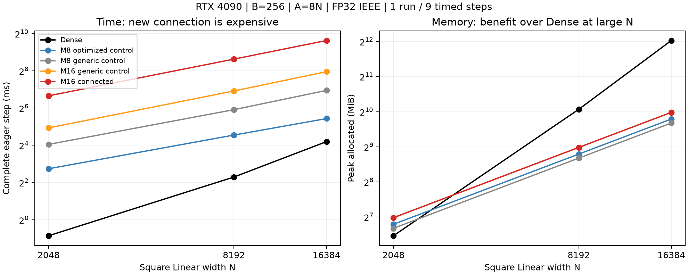

# 接続M16：正しさは通過、費用の条件は未達

[English](connected-m16-results-20261109.md) · [データ](connected-m16-results-20261109.json) · [数式・条件](connected-m16-qualification-20261109.ja.md)

共有モーメントを使うCUDA初版は検証範囲内で正しく動いたが、提案したLM学習比較へ
進むには重い。研究用のままとし、学習・merge・公開採用は行わない。
今回はこの実装の費用の結果であり、タスク精度の結果ではない。



## 同条件の単層Linear測定

RTX4090 24GB、CC8.9、Torch2.9.1+cu128、CUDA12.8、Triton3.5.1、TF32無効。
正方Linear、B256、A=8N、physical FP32行、半径は[.5,32]の対数一様。
手法間でP/X/targetのhashを一致させた。forward・MSE loss・dXを含むbackward・
fused AdamW・半径/座標の射影をすべて測る。各幅・各手法は独立1実験、準備3step、
同期した9標本の中央値。CUDA Graph/captureやFFN・LM全体の測定とはしない。
Denseは通常のnn.Linear初期化による演算・メモリの比較であり、同じ初期関数ではない。
比較用の実験でもDenseを測り直し、近い時間だった。

| N | 最適化M8比較 (ms) | 一般実装M8 (ms) | 一般実装M16 (ms) | 接続M16 (ms) | Dense (ms) |
| ---: | ---: | ---: | ---: | ---: | ---: |
| 2048 | 6.683 | 16.545 | 30.570 | 100.827 | 0.553 |
| 8192 | 23.389 | 60.185 | 120.724 | 394.726 | 4.908 |
| 16384 | 43.250 | 123.379 | 247.865 | 790.352 | 18.339 |

| N | 最適化M8 allocated/reserved (MiB) | 一般実装M8 | 一般実装M16 | 接続M16 | Dense |
| ---: | ---: | ---: | ---: | ---: | ---: |
| 2048 | 110.69 / 122 | 102.15 / 130 | 126.06 / 144 | 126.06 / 144 | 88.25 / 110 |
| 8192 | 442.75 / 486 | 408.97 / 484 | 505.00 / 580 | 505.00 / 580 | 1072.25 / 1342 |
| 16384 | 885.50 / 954 | 818.00 / 870 | 1010.00 / 1122 | 1010.00 / 1122 | 4176.25 / 5190 |

Parameter・勾配・Adam状態・一時領域を含むPyTorch allocatorの絶対ピーク。
GPUプロセス全体は未測定。一般実装の比較条件は初版と同じ一般的な係数計算と、
固定4窓の幾何領域を使い、窓が1つでもその領域を確保する。したがってM16のピークが
同じでも、接続自体にメモリ費用がないとは言えない。最適化M8比較は既存packed/levelsの
演算本体を再利用し、同じphysical正方条件を受け入れる専用macroビルドで測った。
通常バイナリと公開経路の受付条件は変えない。通常の狭い受付条件で最初に拒否された
結果も証拠に保存し、黙って回避したものとして扱わない。

N8192では、一般実装内でM8からM16にすると2.006倍、接続を加えるとさらに3.270倍。
接続M16は最適化M8比較の16.876倍の時間、allocatedは14.06%増。
Dense比ではallocatedが47.10%だが、時間は80.43倍。N16384のallocatedはDenseの24.18%。
N8192から16384への倍幅で初版の時間・メモリはおおむね倍になった。
この3点だけで一般的なスケーリング則を示したとはしない。

## 正しさと範囲

CUDAのFourier係数計算とは独立して、CPU FP64でChebyshev多項式を数値積分する。
全手法についてN128/2048/8192/16384でY・dX・physicalの全4フィールド勾配が通過。
各幅20 Atomであり、性能測定時の全Aを独立oracleで検証したものではない。
旧半径境界、新しい半径/座標接続、広い半径、周回境界、同一サイトの重複像を含む。
幅別照合の最大絶対誤差は1.971e-7、最大相対L2は4.253e-6。
事前の条件はどちらも3e-4以下。通常のAdamWを4step進めたParameter・一次/二次
モーメント・step数も、FP32 optimizer行とFP64定義による参照と比較した。

CPU一式は2,251成功・2,629skip。77a36685のCPU CIも成功。
接続/physicalの対象テストは9成功・GPU用6skip。skipをGPU検証とは数えず、
上記のリモート照合を別の証拠とする。旧optimizerの保存形式を維持し、接続設定が
異なるチェックポイントは拒否することもCPUで確認した。

新AlgorithmのGPU検証はphysical行と一次微分まで。保存する幾何・response・momentは
FP32だが、一般的な係数準備はスレッド内のFP64演算を残す。高階微分、Graph capture、
envelope座標での公開GPU採用、LM用のM16初期化、タスク精度は未検証。
LM学習ジョブは開始していない。次は実装のstep全体の費用を特定して減らす必要がある。
新経路の費用はMの増加だけでは説明できない。

## 再現と保存

候補の時間測定sourceは`494b6da57c8286cb8930c36c5d2cd4e8bcc3ebae`、
最適化比較と幅別照合は`77a366859572fc0cabcc9eacf7a04dfa059e221e`。
接続CUDA演算ファイルは両revisionで同一。日英の条件・Case・研究用Planを保存。
fixtureはsubmission/database adapterで引き続き研究専用として明示的に拒否される。

対応する固定sourceと既存Linear runnerを使う。Nを選ぶ例：

```bash
python -m benchmarks.cuda.linear.run \
  --plans benchmarks/cuda/linear/plans-connected-radius.json \
  --case benchmarks/cuda/linear/cases/connected-radius-8192-r256-c8.json \
  --polar-update radius --source-commit <candidate-source> \
  --output output/connected-8192.json
# 最適化比較はcontrol sourceの *-optimized-control.json Caseを使う。
# --correctness-only は時間測定なしで独立VJP/AdamW照合を実行する。
```

所有ジョブは`connected-m16-4090-20261109-01`（候補）、`-02`（受付条件の拒否）、
`-03`（最適化比較・全幅照合）。すべて終了し、Hubは稼働のままとした。
生結果と固定sourceはリモート永続ボリュームおよびローカルのignored
`output/connected-m16-4090-20261109-01/`に保存。取得archiveのSHA256を照合した。

- 候補結果：`c77c4097001947055354ef1028c8a9132635eef7d83e7f2bb5b3b626f23d3cc0`。
- 最適化比較/照合/拒否結果：`43679f47cc7beb4fa59b1d12790a77a3288d53ff75efd99b3ae3cd5acec9a27c`。
- source archive494b6da5：`0303e3a9c337dcb691cfd4222b9d50a9e4688befca0da73a2b45125ee90cddef`。

整理JSONに手法別標本、allocatorピーク、入力hash、revision、幅別誤差を保存。
Draft PRは#159、#158に積み重ねたもの。

source archive77a36685のSHA256は`1119d75046861f83d9a58e4af71c20d93f405197b50ce2b679fa2b35cff42836`。
46 worker recordの実行source hashを固定archiveと比較し、12,144件すべて一致した。
最後のmetadata受付条件でGPU接続を測定済みの既定M16設定に限定し、
入力/出力で異なる接続設定もGPU実行前に拒否する。
測定条件の既定接続やCUDA演算は変えない。
