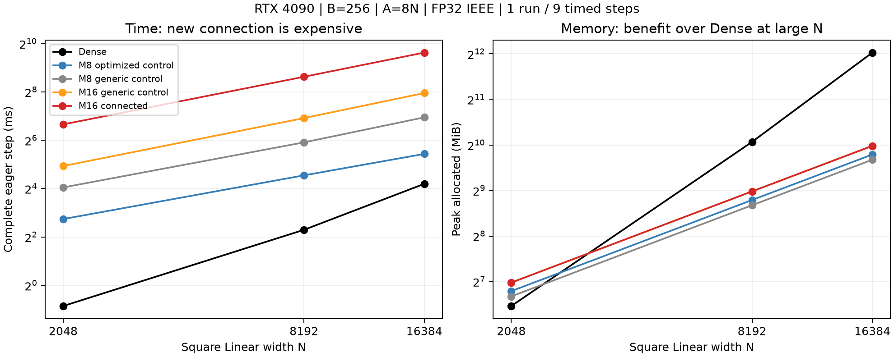

# Connected M16: correctness passed, cost gate failed

[日本語](connected-m16-results-20261109.ja.md) · [Data](connected-m16-results-20261109.json) · [Contract/protocol](connected-m16-qualification-20261109.md)

The first shared-moment CUDA implementation is numerically correct within the
qualification scope, but too expensive to move to the proposed LM learning
comparison. Keep it experimental; no learning, merge or production adoption.
This is a cost result for this implementation, not a task-quality result.



## Matched single-Linear measurements

RTX4090 24GB, CC8.9, Torch2.9.1+cu128, CUDA12.8, Triton3.5.1, TF32 off.
Square Linear, B256, A=8N, physical FP32 rows, radius log-uniform [.5,32], identical
P/X/target hashes across methods. Each measurement includes forward, MSE loss,
backward including dX, fused AdamW and radius/center projection. One independent
run per width/method, 3 warmups and 9 synchronized samples; medians below.
No CUDA Graph/capture or full FFN/LM measurements are claimed. Dense has standard
nn.Linear initialization and compares computation/memory, not an identical
initial function. Dense is remeasured in the control job with close timings.

| N | Optimized M8 control (ms) | Generic M8 (ms) | Generic M16 (ms) | Connected M16 (ms) | Dense (ms) |
| ---: | ---: | ---: | ---: | ---: | ---: |
| 2048 | 6.683 | 16.545 | 30.570 | 100.827 | 0.553 |
| 8192 | 23.389 | 60.185 | 120.724 | 394.726 | 4.908 |
| 16384 | 43.250 | 123.379 | 247.865 | 790.352 | 18.339 |

| N | Optimized M8 allocated/reserved (MiB) | Generic M8 | Generic M16 | Connected M16 | Dense |
| ---: | ---: | ---: | ---: | ---: | ---: |
| 2048 | 110.69 / 122 | 102.15 / 130 | 126.06 / 144 | 126.06 / 144 | 88.25 / 110 |
| 8192 | 442.75 / 486 | 408.97 / 484 | 505.00 / 580 | 505.00 / 580 | 1072.25 / 1342 |
| 16384 | 885.50 / 954 | 818.00 / 870 | 1010.00 / 1122 | 1010.00 / 1122 | 4176.25 / 5190 |

These are absolute PyTorch allocator peaks with resident parameters, gradients,
Adam state and temporaries. GPU process memory was not measured. Generic controls
share the new candidate's generic coefficient preparation and fixed four-window
geometry allocation, even when only one window is active. Therefore the equal
M16 memory peaks do not establish that connection has zero intrinsic overhead.
The optimized M8 control reuses existing packed/levels arithmetic in a separate
macro build admitting the matched physical square fixture. Its ordinary binary
and production support guards remain unchanged. Initial rejection by the
ordinary narrow guard is preserved in the evidence; it was not silently bypassed.

At N8192, changing M8 to M16 within the generic implementation costs2.006x;
connection adds another3.270x. Connected M16 costs16.876x the optimized M8
control and uses14.06% more allocated memory. Against Dense it uses47.10% of
allocated memory but takes80.43x the time. At N16384 its allocated memory is
24.18% of Dense. Doubling N8192 to16384 roughly doubles this candidate's cost
and memory; these three measured widths do not establish a universal scaling law.

## Correctness and limits

An independent CPU FP64 quadrature evaluates the Chebyshev polynomial rather
than the CUDA Fourier coefficient code. Every method passes Y, dX and all four
physical-field VJPs at N128/2048/8192/16384, using20 atoms per width (not a
full-A oracle). Fixtures include old radius thresholds, new scale/position
transitions, broad radii, seam-crossing windows and repeated chart images.
Across the width-specific checks, maximum absolute error is1.971e-7 and maximum
relative L2 error is4.253e-6; the predeclared limits were3e-4 for both.
Four ordinary AdamW steps also compare Parameters, first/second moments and
step counters against the FP64 definition with FP32 optimizer rows.

CPU suite:2,251 passed/2,629 skipped; CPU CI on77a36685 succeeded. Targeted
connected/physical checks:9 passed/6 GPU skips. GPU skipping is not GPU evidence;
the remote qualification above supplies it. CPU checkpoint tests retain legacy
optimizer manifests and reject mismatched connection settings.

The new Algorithm currently qualifies physical rows and first-order gradients.
Its saved geometry, responses and moments are FP32; generic coefficient
preparation still uses thread-local FP64 arithmetic. Higher-order differentiation,
Graph capture, public envelope-coordinate GPU adoption, M16 initialization for
an LM, and task quality remain unqualified. No LM job was started. Further work
must first identify and reduce complete-step implementation cost; increasing M
alone does not describe the total cost of the new connection path.

## Reproduction and preservation

Candidate timing source:`494b6da57c8286cb8930c36c5d2cd4e8bcc3ebae`.
Optimized control and width-specific audit:`77a366859572fc0cabcc9eacf7a04dfa059e221e`.
The connected CUDA arithmetic file is byte-identical between those revisions.
English/Japanese protocol, cases and research Plan registration are versioned.
The fixture remains explicitly rejected by the submission/database adapter.

Use the corresponding frozen source, existing Linear runner and the chosen N:

```bash
python -m benchmarks.cuda.linear.run \
  --plans benchmarks/cuda/linear/plans-connected-radius.json \
  --case benchmarks/cuda/linear/cases/connected-radius-8192-r256-c8.json \
  --polar-update radius --source-commit <candidate-source> \
  --output output/connected-8192.json
# Optimized control: the separate *-optimized-control.json Case at control source.
# --correctness-only runs the independent VJP/AdamW audit without timing.
```

Owned jobs:`connected-m16-4090-20261109-01` (candidate),`-02` (guard rejection),
`-03` (qualified optimized control/all-width audits). All finished; the Hub was
left running. Raw outputs and frozen source archives are preserved both on the
remote persistent volume and locally in ignored
`output/connected-m16-4090-20261109-01/`. Downloaded archives were SHA256-verified:

- Candidate results:`c77c4097001947055354ef1028c8a9132635eef7d83e7f2bb5b3b626f23d3cc0`.
- Control/audits, including the rejected setup:`43679f47cc7beb4fa59b1d12790a77a3288d53ff75efd99b3ae3cd5acec9a27c`.
- Source archive494b6da5:`0303e3a9c337dcb691cfd4222b9d50a9e4688befca0da73a2b45125ee90cddef`.

The curated JSON retains per-method samples, allocator peaks, input hashes,
exact revisions and width-specific errors. Draft PR:#159, stacked on#158.

Source archive77a36685 SHA256:`1119d75046861f83d9a58e4af71c20d93f405197b50ce2b679fa2b35cff42836`.
All12,144 executed-source hash comparisons across46 worker records match their
frozen archives. The final metadata admission checks restrict GPU connection to measured default
M16 settings (and reject unequal
input/output connection settings) before GPU execution; it does not change the
measured default connection or CUDA arithmetic.
