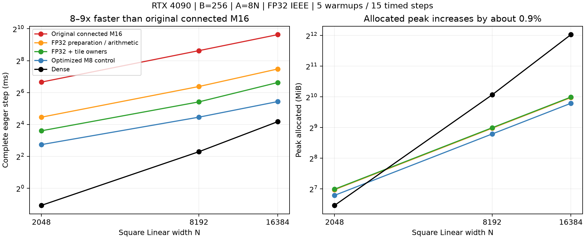

# 接続M16：FP32演算とタイル所有者による集約

[English](connected-m16-reuse-results-20261109.md) · [データ](connected-m16-reuse-results-20261109.json) · [条件](connected-m16-reuse-20261109.ja.md)

接続M16は初版から約8〜9倍速くなり、allocatedピークの増加は約0.9%。
独立FP64の小規模照合、optimizer状態、全形状での比較が通過した。
単層Linearの研究用結果であり、公開既定値・optimizer・数式の変更、GraphやLM精度の採用結果ではない。



## step全体の結果

RTX4090 24GB/CC8.9、Torch2.9.1+cu128、CUDA12.8、Triton3.5.1、FP32 IEEE、TF32無効。
正方Linear、B256,A8N。手法・source間で同じseedのphysical P/X/target hashを一致させた。
半径は[.5,32]の対数一様。幾何・sort/range・forward/MSE/backward/dX・fused AdamW・
半径/座標の射影まで含む。各workerで5回準備、同期した15stepの中央値を示す。
初期化/JITと独立照合は採用用の時間に含めない。Denseは通常初期化の費用比較であり、
同じ初期関数ではない。FFN/LM全体やGraph/captureの速度・メモリとはしない。

| N | 接続M16初版 ms | FP32版 ms | 行/タイル再利用 ms | owner版 ms | owner高速化 | 最適化M8 ms | Dense ms |
| ---: | ---: | ---: | ---: | ---: | ---: | ---: | ---: |
| 2048 | 100.889 | 21.988 | 11.549 | 12.173 | 8.29倍 | 6.679 | 0.477 |
| 8192 | 395.445 | 83.289 | 44.106 | 42.719 | 9.26倍 | 21.992 | 4.906 |
| 16384 | 792.100 | 178.162 | 99.102 | 98.993 | 8.00倍 | 43.269 | 18.079 |

最初の3手法とM8/Dense対照はsource2d86d0e9、ownerは67ddf2e5。
数式・fixtureは同一。後者で行/タイル再利用も測り直し、12.331/44.097/99.002msだった。
2048には実行/source間の変動があり、ownerが明確に有利とは言えない。16384も差は小さい。
行まとめの普遍的な優劣とせず、両方のscheduleを保存する。

8192は状態を持ち越さない別workerの独立実行で再確認した。

| 比較 | 初回 ms | 再測定 ms |
| --- | ---: | ---: |
| 接続M16初版 | 395.445 | 394.761 |
| FP32版 | 83.289 | 83.478 |
| 行/タイル再利用、source2d86d0e9 | 44.106 | 44.104 |
| 行/タイル再利用、source67ddf2e5 | 44.097 | 43.983 |
| owner、source67ddf2e5 | 42.719 | 42.806 |

このN8192/B256条件ではownerに小さいが繰り返した優位があった。
固定したベンチマーク内のopt-inであり、公開dispatcherの選択規則ではない。
同じ実行内の標本を独立実験数とは数えない。

| N | 初版 allocated/reserved MiB | FP32 allocated/reserved MiB | 行/タイル・owner allocated/reserved MiB | Dense allocated/reserved MiB |
| ---: | ---: | ---: | ---: | ---: |
| 2048 | 126.06 / 144 | 126.06 / 144 | 127.18 / 146 | 88.25 / 110 |
| 8192 | 505.00 / 580 | 505.00 / 580 | 509.50 / 580 | 1072.25 / 1342 |
| 16384 | 1010.00 / 1122 | 1010.00 / 1122 | 1019.00 / 1146 | 4176.25 / 5190 |

Parameter・勾配・Adam状態・一時領域を含むPyTorch allocatorの絶対ピーク。
追加の保存routing範囲が8192で約4.5MiB。GPUプロセス全体は未測定。
8192のownerは最適化M8の約1.94倍、Denseの約8.7倍の時間がかかる一方、
allocatedはDenseの約47.5%。初版からの8〜9倍改善と併せて、この差も残す。

## 変更点

係数と位相の準備を含むGPUのタスク演算をFP32にした。
不変なhostの幾何宣言と独立CPU参照はFP64を維持する。
初版ではdoubleの`PI`定数により、射影・scatterの内側の角度計算もfloat変換前に
FP64へ昇格していた。FP32版はそこも直しており、準備だけを変えた効果ではない。

- 一般的な漸化式/DFT準備を、正の同次M16 Fourier多項式と解析的な半径微分に置換。
  同じ階層の係数を両窓・両軸で使い回す。
- 8行で幾何を再利用し、子タイルのDC/偶数周波数モーメントも使い回す。
  再利用側の照会にはK3の定数回転を使う。
- 現在の幾何から毎forwardのroutingを構築。Atomごとの係数global atomicに代わり、
  所有タイルで一度集約して書く。小さいタイルも局所集約してからbank間を加算する。
- Hは振幅を掛ける前、ParameterはA×4、入力/出力混合の交差項と混合比の全微分を維持。
  密行列Wや永続的な学習可能仮想Atomは作らない。保存routingは呼出し単位で、
  通常のSavedVariable version検査を使う。backwardはHと微分を再計算する。

`owner`はタイル所有・結合モーメントを維持し、行単位のresponseと通常の勾配照会を使う。
`reuse`との比較はこの照会の組も変わるため、行数だけを変える純粋な1変数実験ではない。
この接続M16実装では、行再利用が普遍的に有利とはならなかった。

別の計測を挿入したN8192の診断（各3step、採用用step時間とは別）では、主なGPU内訳は次の通り。

| 処理 | FP32版 ms/step | 行/タイル再利用 ms/step |
| --- | ---: | ---: |
| 幾何/係数準備 | 1.111 | 1.134 |
| response射影 | 18.182 | 19.690 |
| 係数scatter / 所有タイル展開 | 45.663 | 5.567 |
| Parameter勾配 | 16.389 | 17.093 |
| 最後のサイト展開 | 0.762 | 0.779 |
| モーメント構築 | 0.590 | 0.520 |

集約の効果を切り分ける診断であり、足し引きしてstep全体の速度としない。
追加の逆アセンブル監査はcuobjdump未導入のため実行できず、静的命令数の主張はしない。

## 正しさと再現

事前条件の絶対最大誤差・相対L2はどちらも3e-4以下のまま。
独立CPU FP64のChebyshev数値積分で各幅20 Atomの全サイト、Y/dX/physical全4勾配を
照合し、半径/座標接続と周回重複像も含めた。両sourceを通した最大絶対誤差は5.953e-7、
相対L2は2.204e-5。AdamWを4step進めたParameter・モーメント・step数も通過した。

加えてN2048/8192/16384で全B・全AのGPU比較を行い、全出力・dX・全Atom勾配を確認。
FP32/行・タイル版と検証済み初版CUDAとの最大絶対誤差は8.500e-5、相対L2は3.905e-6。
ownerと検証済み行/タイル版は最大絶対誤差5.365e-6、相対L2は6.543e-8。
全形状比較は独立primitive oracleを補完するもので、全AのCPU FP64照合ではない。

GPU pytestは2d86d0e9で10成功、67ddf2e5で14成功。
行数1/7/65/256、非連続入力/dY、retainと複数の未backward forward、変異検出を含む。
ローカルCPU一式は2d86d0e9で2253成功/2637skip、最新の対象CPUは9成功/ GPU用12skip。
両実行sourceのCPU CIとwheel/sdist作成も成功。skipをGPUの証拠とは数えない。
高階微分、Graph、envelope座標での公開統合、LM精度は未検証のまま。

対応する固定sourceと既存runnerで再現する。

```bash
python -m benchmarks.cuda.linear.run \
  --plans benchmarks/cuda/linear/plans-connected-radius-reuse.json \
  --case benchmarks/cuda/linear/cases/connected-radius-8192-r256-c8-reuse.json \
  --polar-update radius --source-commit <source> --output output/reuse-8192.json
# owner比較は67ddf2e5の *-reuse-owner.json を使う。
# --correctness-only は時間測定なしで独立照合を行う。
python -m pytest -q tests/test_connected_m16_reuse.py
```

厳密な多項式生成器でcommit済みheader/fixtureが再生成できることも確認。
生結果・controller・profile・固定sourceをリモート永続領域とローカルのignored
`output/connected-m16-reuse-4090-20261109-01/`および`-02/`に保存してhash照合した。
36+20 worker record、15,064件の実行source hashがarchiveと一致。
整理JSONには標本、source別比較、入力hash、allocatorピーク、小規模/全形状誤差、
archive/source hashを残す。所有ジョブはすべて終了しHubは稼働のまま。
PR160は159に積み重ねたもので、merge・既定値への採用は行わない。
