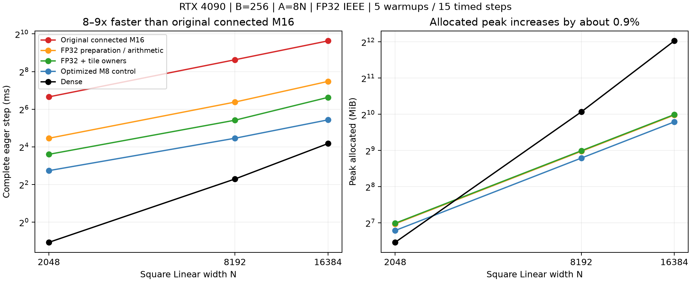

# Connected M16: FP32 arithmetic and tile-owner aggregation

[日本語](connected-m16-reuse-results-20261109.ja.md) · [Data](connected-m16-reuse-results-20261109.json) · [Protocol](connected-m16-reuse-20261109.md)

The connected M16 candidate is now about8–9x faster than its first implementation,
with about0.9% more peak allocated memory. Independent FP64 primitive checks,
optimizer-state checks and full-shape comparisons passed. This is an experimental
single-Linear result; no public default, optimizer, mathematical definition,
Graph or LM-quality change is adopted.



## Complete-step results

RTX4090 24GB/CC8.9, Torch2.9.1+cu128, CUDA12.8, Triton3.5.1, FP32 IEEE/TF32 off.
Square Linear, B256,A8N; same seeded physical P/X/target hashes across methods and
source snapshots. Radii are log-uniform[.5,32]. Measurements include geometry,
sorting/ranges, forward/MSE/backward/dX/fused AdamW and radius/center projection.
5 warmups/15 synchronized eager steps per worker; each row below is one run's
median. Setup/JIT and independent correctness are outside adoption timing.
Dense uses standard nn.Linear initialization as a cost control, not the same
initial function. No full FFN/LM or Graph/capture timing/memory is claimed.

| N | Original connected M16 ms | FP32 recipe ms | Row/tile reuse ms | Owner recipe ms | Owner speedup | Optimized M8 ms | Dense ms |
| ---: | ---: | ---: | ---: | ---: | ---: | ---: | ---: |
| 2048 | 100.889 | 21.988 | 11.549 | 12.173 | 8.29x | 6.679 | 0.477 |
| 8192 | 395.445 | 83.289 | 44.106 | 42.719 | 9.26x | 21.992 | 4.906 |
| 16384 | 792.100 | 178.162 | 99.102 | 98.993 | 8.00x | 43.269 | 18.079 |

The first three recipe columns and M8/Dense controls use source2d86d0e9; owner
uses67ddf2e5. Both keep exactly the same mathematical declaration and fixture.
The latter source separately remeasured row/tile reuse at12.331/44.097/99.002ms.
Therefore N2048 has some between-run/source variation; owner has no clear
advantage there or at N16384. Preserve both schedules rather than infer a
universal row-grouping rule.

N8192 was repeated in independent fresh-worker jobs:

| Comparison | First run ms | Repeat ms |
| --- | ---: | ---: |
| Original connected M16 | 395.445 | 394.761 |
| FP32 recipe | 83.289 | 83.478 |
| Row/tile reuse, source2d86d0e9 | 44.106 | 44.104 |
| Row/tile reuse, source67ddf2e5 | 44.097 | 43.983 |
| Owner recipe, source67ddf2e5 | 42.719 | 42.806 |

The owner schedule has a small, repeated advantage at this exact N8192/B256
cohort. It is a benchmark-local opt-in, not a production dispatcher rule.
Timing samples within one run are not independent experiments.

| N | Original allocated/reserved MiB | FP32 allocated/reserved MiB | Row/tile and owner allocated/reserved MiB | Dense allocated/reserved MiB |
| ---: | ---: | ---: | ---: | ---: |
| 2048 | 126.06 / 144 | 126.06 / 144 | 127.18 / 146 | 88.25 / 110 |
| 8192 | 505.00 / 580 | 505.00 / 580 | 509.50 / 580 | 1072.25 / 1342 |
| 16384 | 1010.00 / 1122 | 1010.00 / 1122 | 1019.00 / 1146 | 4176.25 / 5190 |

Absolute PyTorch allocator peaks include resident Parameters, gradients, Adam
state and temporaries. The additional saved routing ranges account for about
4.5MiB at N8192. Total GPU process usage was not measured. At that width owner
is still about1.94x the optimized M8 time and8.7x Dense, while using47.5% of
Dense allocated memory. Keep these limits alongside the8–9x implementation gain.

## What changed

All GPU task arithmetic, including coefficient and phase preparation, uses
FP32. Immutable host geometry declarations and independent CPU references retain
FP64. The original source also promoted hot projection/scatter phase arithmetic
through its double `PI` constant before converting to float. FP32 conversion
there is included in the FP32 recipe; the gain is not solely a preparation gain.

- Replace generic recurrence/DFT preparation with positive homogeneous M16
  Fourier polynomials and their analytic radius derivatives. One scale's
  coefficients serve both position windows and both axes.
- Reuse geometry across8 response rows and inherit DC/even-frequency moments
  from child tiles; use exact K3 rotation constants in the reuse query.
- Build routing from live geometry on every forward. A tile owner accumulates
  its wide coefficients once rather than issuing per-Atom global coefficient
  atomics. Small direct tiles reduce locally before adding across banks.
- Keep H before amplitude, fixed A×4 Parameters, complete input/output mixture
  cross terms and both blend-weight derivatives. No dense W or persistent
  trainable virtual Atoms. Per-invocation saved routing is guarded by normal
  SavedVariable version checks. Backward recomputes H/derivatives.

The `owner` recipe keeps tile ownership/merged moments but uses per-row response
and the ordinary gradient query. Its contrast to `reuse` changes that query
bundle too; it is not a pure row-count-only experiment. Row reuse did not provide
a universal benefit in this connected M16 implementation.

Separate instrumented N8192 diagnostics, three steps per recipe (not adoption
step timing), gave these main GPU kernel groups:

| Group | FP32 recipe ms/step | Row/tile reuse ms/step |
| --- | ---: | ---: |
| Geometry/coefficient preparation | 1.111 | 1.134 |
| Response projection | 18.182 | 19.690 |
| Coefficient scatter / tile-owner expansion | 45.663 | 5.567 |
| Parameter gradient | 16.389 | 17.093 |
| Final site expansion | 0.762 | 0.779 |
| Moment construction | 0.590 | 0.520 |

These diagnose why tile aggregation matters; they are not summed/subtracted to
manufacture the primary step result. An optional machine-disassembly audit could
not run because cuobjdump was absent. No static instruction-count claim is made.

## Correctness and reproducibility

Predeclared max-absolute and relative-L2 gates remain3e-4. Independent CPU FP64
Chebyshev quadrature checks all sites, Y/dX/all four physical-field VJPs at
20 diagnostic Atoms per width, including scale/position joins and repeated chart
images. Across both sources the largest primitive absolute error is5.953e-7,
relative L2 is2.204e-5. Four-step AdamW Parameter, moment and counter gates pass.

Additional full-B/full-A GPU comparisons at N2048/8192/16384 check all outputs,
dX and every Atom gradient. FP32/row-tile recipes versus the qualified original
CUDA path reach max absolute8.500e-5 and relative L2 3.905e-6. Owner versus the
qualified row/tile path reaches max absolute5.365e-6, relative L2 6.543e-8.
These full-shape checks supplement, and do not replace, the independent primitive
oracle; they are not full-A CPU FP64 checks.

GPU pytest:10 passed at2d86d0e9, then14 passed at67ddf2e5, covering rows1/7/65/256,
noncontiguous input/dY, retained and multiple outstanding forwards, and mutation
protection. Local CPU suite at2d86d0e9:2253 passed/2637 skipped; targeted latest
CPU checks:9 passed/12 GPU skips. CPU CI plus wheel/sdist build passed at both
execution sources. Skips are not GPU evidence. Higher-order gradients, Graphs,
envelope-coordinate public integration and LM quality remain unqualified.

Reproduce from the indicated source with the existing runner:

```bash
python -m benchmarks.cuda.linear.run \
  --plans benchmarks/cuda/linear/plans-connected-radius-reuse.json \
  --case benchmarks/cuda/linear/cases/connected-radius-8192-r256-c8-reuse.json \
  --polar-update radius --source-commit <source> --output output/reuse-8192.json
# Owner ablation uses *-reuse-owner.json at67ddf2e5.
# --correctness-only executes independent gates without performance measurement.
python -m pytest -q tests/test_connected_m16_reuse.py
```

The exact polynomial generator reproduces the committed header and fixture.
Raw results/controllers, profiles and immutable source archives have verified
remote-persistent and local copies under ignored
`output/connected-m16-reuse-4090-20261109-01/` and`-02/`.
36+20 worker records match their archives in15,064 executed-source hash checks.
Curated JSON retains samples, per-source comparisons, input hashes, allocator
peaks, primitive/large errors and archive/source hashes. All owned jobs finished;
the Hub remained running. PR160 is stacked on159; no merge/default adoption.
