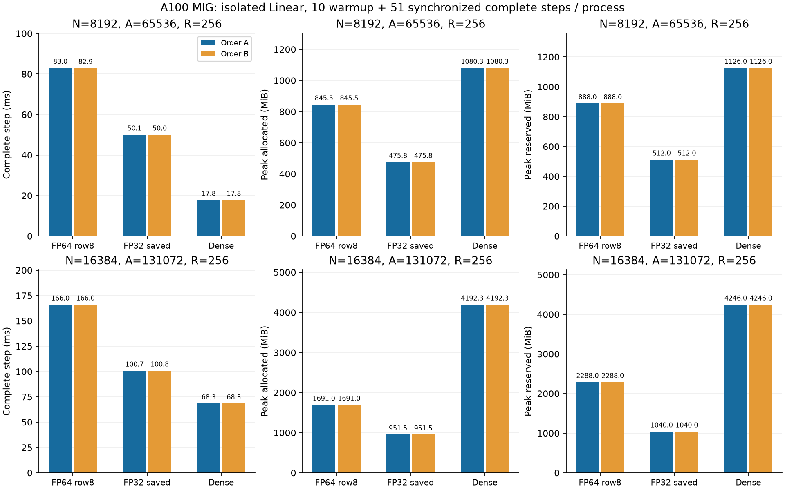

# 大きい幅での多入力Linear比較

[English](large-multirow-20261107.md) | **日本語**

ユーザーが性能比較の本命を幅8192・16384へ移した。先の[小型FFN](multirow-packed-20261107.ja.md)
ではトークン行数256とモデル幅256だった。今回は正方CSTLinearで、幅16384のLM全体ではない。

A10080GBPCIe MIG3g.40gb、FP32 IEEE/TF32 off、常駐入力R=256行、N=8192/16384、
A=8N（65536/131072 Atom）、modes8/base1/merge2/spacing1/origin0を固定する。
minimum-001：radius[.5,50]、birth.5、upper_floor1、rational_zero_opening tau.001、初期q0。
活性化を挟まないLinearなのでpublic Xavier gain1を使う。実際に公開初期化した座標・振幅である。
Atom数・LR・envelopeのsweepはしない。c固定で線形Atom数の性能を見るもので、精度・下限研究ではない。

既存小型Planの制限とproduction非登録は維持する。大規模専用row8/FP32並列IDを用意し、
正方N2048/8192/16384、R1〜256、A4〜8Nのみ許可する。小Atomは添字・独立求積用、実測は8N。
旧productionの許可条件、Graph拒否、支持・正規化、native Polar finite_chord更新は維持する。
CUDA算術bodyを再利用し、大規模の明示scopeを追加する。Graph・別GPUは未検証。

大きい幅の初期化は局所セル質量のノルムで同じ符号期待energyを求める。周期画像は足してから二乗する。
幅1024以下の既存factorノルム計算は維持。CPU局所Fourier参照は64Atom単位で全site・全Atomを確認する。
Denseは同じCST有効演算子をCPUのAtom順FP32局所scatterでexportして初期化する
（chunk64、maximum_outer_product_values1048576）。従来identity/GEMM exportとは丸め順が異なる
明示policyである。dense WはDense初期化専用で、CSTがW/dWを保存する方式ではない。
入力Tensor・hash、source、export policy、初期Dense W content hashを保全する。

計時前に既存multirow/global回帰と新しい大規模添字・端数を検査し、N16384のsigned32超owner keyを含める。
N2048/A16384/R256で全Y/dX/dPをpublic CPU FP64局所Fourierと照合し、8Atom独立polynomial求積
（幅decodeはpublic）で補完する。既存Linear runnerのCPU FP32 matched-state3更新と、同一GPU勾配を
使うoptimizer wrapper byte gateを再利用する。新fixtureのParameterはユーザーが許容した
atol3e-5/rtol3e-4、既存の全演算基準（最大絶対・相対L2とも5e-4以内）、勾配・Adam基準は維持する。
実測する両幅でも実更新の前後に全Atom VJPを確認する。数学基準不合格・nonfinite・OOM・時間上限で止め、
失敗を保全する。

既存`benchmarks.cuda.linear.run` workerを使い、学習・計時loopを新設しない。新fixtureは旧radius同様
研究専用でDB adapterが拒否する。source hashに局所参照/exporterを含める。
FP64 row8、FP32保存＋並列、Denseをfresh processで実行する。
A順は幅8192→16384、条件row8→FP32→Dense、B順は幅16384→8192、条件Dense→FP32→row8。
同allocationで各幅・各条件2観測であり、独立hardware再現とはしない。

各観測はwarmup10＋計時51の実更新。同期した完全stepはzero_grad、dX消去、forward/MSE/backward
（dX含む）、fused AdamW/native Polar。常駐random x/target（seed41）、lr1e-4、weight_decay0、biasなし。
転送、CPU初期化/export、初期検証、compile、更新後検証・hash化は計時外。
allocated/reserved peakは61更新全部を含み、GPU process全使用量は測らない。
51 sample全部、初期・更新後radius分布、最終Parameter/勾配/Adam/clockのTensor hashと初期条件を保全する。
両順序と初期検証込みsetupを分けて報告し、単独Linearの時計をLM全体の時計と接合しない。
この更新は収束や大規模モデルの精度優位性を示す実験ではない。

## 監査済み結果

数値計算コミット：`3dd8115d09251146d9fbdc8876f9a7dc99b61f01`。
12観測すべてが初期・更新後の全VJP検証に合格し、N2048の検証と152件の
CPU/CUDA回帰も合格した。同条件の最終Parameter・勾配・Adam moment・clock
ハッシュは両実行順で完全一致した。

| N | Implementation | Step ms A / B | Allocated MiB A / B | Reserved MiB A / B | Setup s A / B |
| ---: | --- | ---: | ---: | ---: | ---: |
| 8192 | FP64 row8 | 82.987 / 82.932 | 845.511 / 845.511 | 888 / 888 | 27.80 / 25.97 |
| 8192 | FP32 saved | 50.055 / 50.040 | 475.761 / 475.761 | 512 / 512 | 27.13 / 26.31 |
| 8192 | Dense | 17.845 / 17.850 | 1080.251 / 1080.251 | 1126 / 1126 | 11.55 / 11.61 |
| 16384 | FP64 row8 | 165.991 / 166.030 | 1691.011 / 1691.011 | 2288 / 2288 | 91.15 / 91.41 |
| 16384 | FP32 saved | 100.713 / 100.773 | 951.511 / 951.511 | 1040 / 1040 | 88.89 / 89.41 |
| 16384 | Dense | 68.278 / 68.316 | 4192.251 / 4192.251 | 4246 / 4246 | 24.65 / 26.11 |

R256ではFP32がFP64 row8より約39.3〜39.7%短時間になった。一方、Dense比では
N8192で2.80倍、N16384で1.475倍の時間が必要である。allocated peakはDenseの
44.0%・22.7%。Nを倍にするとCSTの時間は約2倍、Denseは約3.83倍だった。
固定R・A8Nでの幅スケールの観測であり、漸近的な下限や精度保証ではない。
Rの効果は別の対照実験で確認する。

[機械可読集計](large-multirow-results-20261107.json)に両順序と元結果のハッシュを残した。
ローカル証拠はownerのcanonical checkoutの`output/large-multirow-20261107-01`。
証拠archive SHA256は
`6c8ddfde81e67bfe38ae2b43ab55ca5edfe5408b3e0b180b4ad6e80ec7786b2b`で、
44ファイルの原本を照合した。実際の初期Tensorも独立復元した。入力archive SHA256：
`cd462b632bb46a55cafb45817e9f232fe2e371d852b073083230b79ed9d12e5e`。
最終状態はTensorハッシュを保全したもので、最終model/optimizer payloadや
生のoracle Tensorはarchiveしていない。所有するcontroller/workerの18 PIDの
終了とsource・extensionハッシュを確認した。サーバーや無関係なjobには触れていない。
公開既定値・dispatcherへの採用は含まない。
