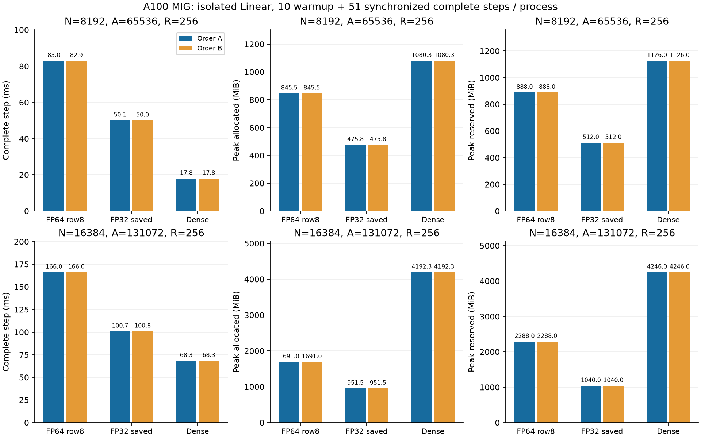

# Large-width multirow Linear comparison

**English** | [日本語](large-multirow-20261107.ja.md)

The user moved the primary performance question to widths 8192 and 16384.
The preceding small FFN record is [separate](multirow-packed-20261107.md): its
256 token rows and model width256 must not be confused with the large widths.
This study measures square CSTLinear, not a full width16384 language model.

Fixed cohort: A10080GBPCIe MIG3g.40gb, FP32 IEEE/TF32 off, R=256 resident rows,
N=8192 and16384, A=8N (65536/131072 Atoms), modes8/base1/merge2/spacing1/origin0.
The two-chart kernel is minimum-001: radius[.5,50], birth.5, upper_floor1,
rational_zero_opening tau.001, q0 at initialization. Use public Xavier gain1
(there is no ReLU in this isolated Linear). Centers and amplitudes are actual
public initialized Parameters. No Atom-count, learning-rate or envelope sweep.
This is fixed-c linear-Atom-count performance, not an accuracy/lower-bound study.

The original small Plans stay narrow and unregistered in production. Separate
large row8 and FP32-parallel IDs admit square N2048/8192/16384, R1..256, A4..8N;
small A is for indexing/independent quadrature only. Actual measurements use8N.
Old production admission, Graph rejection, support, normalization and the native
Polar finite_chord update remain unchanged. The CUDA arithmetic body is reused;
only the explicit large scope is added. Graph and other hardware are unqualified.

Large initialization evaluates the same sign-energy target through local cell
mass norms; repeated periodic images are added before squaring. Widths<=1024
keep the old factor-norm calculation. Bounded CPU local Fourier reference checks
all sites/all Atoms in64-Atom chunks. Dense starts from the same effective CST
operator, exported on CPU by local atom-major FP32 scatter (chunk64,
maximum_outer_product_values1048576). This explicit export policy differs in
rounding order from historical identity/GEMM export. Dense W is initialization
only; CST execution does not store a dense W/dW. Preserve input tensors and hashes,
source, export policy and initial Dense W content hash.

Before timing, run the existing multirow/global regression tests and new wide
index/tail tests, including a signed32-exceeding owner key atN16384. Qualify
N2048/A16384/R256 with full Y/dX/all-dP against public CPU FP64 local Fourier,
and an eight-Atom independent polynomial-quadrature supplement (public width
decode). Reuse the existing Linear runner's three matched-state CPU FP32 update
checks and same-gradient GPU optimizer-wrapper byte gate. The new fixture uses
the user-authorized Parameter atol3e-5/rtol3e-4; existing full operator gates
(max absolute and relativeL2<=5e-4), gradient/Adam checks remain unchanged.
Both measured widths also check all-Atom VJPs before and after their actual updates.
Stop on failed mathematical gates, nonfinite, OOM or timeout; retain failures.

Use the existing `benchmarks.cuda.linear.run` workers, no new training/timing
loop. The new fixture is explicitly research-only and rejected by the database
adapter, like the original radius fixture. Source hashes include the bounded
reference/exporter. Run each arm in a fresh process: FP64 row8, FP32 saved+
parallel and Dense. OrderA: widths8192→16384, armsrow8→FP32→Dense;
orderB: widths16384→8192, armsDense→FP32→row8. One allocation, two observations
per arm/width; do not treat them as independent hardware replication.

Each observation executes10 warmups plus51 timed, synchronized, complete steps:
zero_grad, clear dX, forward/MSE/backward including dX, fused AdamW/native Polar.
Fixed resident random x/target (seed41), lr1e-4, weight_decay0, biasFalse. Data
transfer, CPU initialization/export, initial proof, compile, updated-state proof
and hashing are outside the step clock. Peak allocated/reserved includes all61
training steps; total GPU process usage is unmeasured. Preserve all51 samples,
initial/updated radius distributions, final Parameter/gradient/Adam/clock Tensor
hashes and initial conditions. Report both orders and setup including initial
proof separately. Do not join these isolated-Linear timings to whole-LM timings.
These updates do not establish convergence or a large-model accuracy advantage.

## Audited results

Numeric commit: `3dd8115d09251146d9fbdc8876f9a7dc99b61f01`.
All12 observations passed initial and updated full VJP checks; N2048 qualification
and152 CPU/CUDA regressions passed. Corresponding final Parameters, gradients,
Adam moments and clock hashes matched exactly between the two orders.

| N | Implementation | Step ms A / B | Allocated MiB A / B | Reserved MiB A / B | Setup s A / B |
| ---: | --- | ---: | ---: | ---: | ---: |
| 8192 | FP64 row8 | 82.987 / 82.932 | 845.511 / 845.511 | 888 / 888 | 27.80 / 25.97 |
| 8192 | FP32 saved | 50.055 / 50.040 | 475.761 / 475.761 | 512 / 512 | 27.13 / 26.31 |
| 8192 | Dense | 17.845 / 17.850 | 1080.251 / 1080.251 | 1126 / 1126 | 11.55 / 11.61 |
| 16384 | FP64 row8 | 165.991 / 166.030 | 1691.011 / 1691.011 | 2288 / 2288 | 91.15 / 91.41 |
| 16384 | FP32 saved | 100.713 / 100.773 | 951.511 / 951.511 | 1040 / 1040 | 88.89 / 89.41 |
| 16384 | Dense | 68.278 / 68.316 | 4192.251 / 4192.251 | 4246 / 4246 | 24.65 / 26.11 |

At R256, FP32 cuts time about39.3–39.7% versus FP64 row8. It remains2.80× Dense
at N8192 and1.475× Dense at N16384. Allocated peaks are44.0% and22.7% of Dense.
Doubling N doubles CST time, while Dense time grows about3.83× in this cohort.
This is favorable width scaling at fixed R and A8N, not a measured asymptotic
bound or accuracy guarantee. Changing R requires its own controlled comparison.

[Machine-readable aggregate](large-multirow-results-20261107.json) retains both
orders and raw-result hashes. Local evidence root:
`output/large-multirow-20261107-01` in the owner's canonical checkout.
Evidence archive SHA256:
`6c8ddfde81e67bfe38ae2b43ab55ca5edfe5408b3e0b180b4ad6e80ec7786b2b`;
44 compact originals verified. Actual initial tensors were independently restored
from archive SHA256
`cd462b632bb46a55cafb45817e9f232fe2e371d852b073083230b79ed9d12e5e`.
Final-state Tensor hashes, not final model/optimizer payloads, were preserved;
raw oracle tensors were not archived. All18 owned controller/worker PIDs ended;
source and extension hashes were checked. The server and unrelated jobs remain
untouched. No public default or dispatcher adoption is included.
