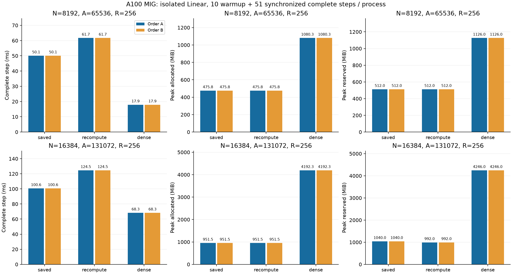

# 大きな幅での応答再計算

[English](large-recompute-20261108.md) | **日本語**

同じA100 MIG 3g.40gbでR=256、正方N=8192/16384、A=8Nの応答保存と
再計算を比較する。振幅・半径の法則、初期化、FP32演算、TF32無効、
optimizerは変更しない。追加Algorithmは既存の再計算実装を検証済みの
大規模正方スコープへ宣言するだけで、benchmark限定の明示選択とする。
この宣言に新しいCUDA数値計算コードはない。

幅比較で検証した凍結P/x/target/dYを使う。N=2048の検証用payloadも使う。
prefix adapterはpayloadハッシュと再生成したP・初期化校正を確認して、
既存Linear workerを呼ぶ。コミット済みソースの新しいスナップショットと
独立した拡張ビルドで識別する。CUDA回帰後、N2048再計算の正しさ・optimizer
検証を実施する。大きな幅でも初期・更新後の全要素FP64 VJP検証を維持する。

各arm・幅で独立プロセス2回。Aは幅8192→16384、保存→再計算→Dense、
Bは幅16384→8192、Dense→再計算→保存。各10 warmupと51計測の同期した
完全stepを実行する。zero_grad、dX消去、forward/MSE、backward、optimizerを
含め、準備・CPU検証・結果保存を除く。allocatorピークは全61stepを含む。
allocatedとreservedを別記し、プロセス全体のメモリとは呼ばない。
正しさ失敗・非有限値・OOM・timeoutで停止し、証拠を残し自動再試行しない。
状態ハッシュ、保持方式の保存領域、全観測を比較する。長時間学習・LM全体の
精度・CUDA Graph・別デバイスについては主張しない。

再計算ではforwardのZ/H保持を解除するが、backwardでは逆向き中間値が
生きたままZ/Hを再生成する。単独の大きなLinearでは一時領域のピークが
変わらない可能性がある。節約を仮定せず交換条件を測る。多層LMでの以前の
結果だけでは、このピークは決まらない。

上記の固定プロトコルに沿って実行した。監査済み結果を以下に記す。

## 作業領域の内訳

正方chart・M=8・direct levels2では、FP32 moment一つが
`Z_bytes = 4 R (N-2) (2M+1)`、応答一つが`H_bytes = 4 R A`。
勾配partialは`12 A ceil(R/8)` byte、geometryは`100 A` byteである。
N16384/A131072/R256ではZ一つ271.967MiB、H/G一つ128MiB、partial48MiB、
geometry12.5MiB。両向き分を合わせて約860.434MiBになり、さらに入力・出力・勾配・
optimizer・owner metadataが加わる。通常の再計算もbackwardピークでは同じ作業領域を
再生成する。これはshapeから求めたTensor payloadで、allocatorピークの実測や
GPUプロセス全使用量ではない。

## 監査済み結果

数値計算コミット`73e6a51cb0ec92bf26f254d25e71c2f1300febf3`。CPU/CUDA回帰156件に合格。
N2048の検証と大規模各観測の初期・更新後全VJPも既存基準で合格した。両順序を保全する。

| N | Arm | Step ms A / B | Allocated MiB A / B | Reserved MiB A / B |
| ---: | --- | ---: | ---: | ---: |
| 8192 | saved | 50.056 / 50.068 | 475.761 / 475.761 | 512 / 512 |
| 8192 | recompute | 61.680 / 61.681 | 475.761 / 475.761 | 512 / 512 |
| 8192 | dense | 17.858 / 17.853 | 1080.251 / 1080.251 | 1126 / 1126 |
| 16384 | saved | 100.641 / 100.640 | 951.511 / 951.511 | 1040 / 1040 |
| 16384 | recompute | 124.526 / 124.545 | 951.511 / 951.511 | 992 / 992 |
| 16384 | dense | 68.284 / 68.275 | 4192.251 / 4192.251 | 4246 / 4246 |

[機械可読集計](large-recompute-20261108-results.json)に元結果のhashと最終状態の一致判定を記録した。
canonical証拠：`output/large-recompute-20261108-01`。archive SHA256：
`a09708ca61cb0479cf09ca276681e6df5c01bd22d04c96a63c5457e0e4fcd078`。43原本を照合し、所有controller/worker
PIDの終了、凍結source・binary・入力hashを確認。実初期Tensorは幅比較で独立復元済み。
最終状態はParameter/勾配/Adam/clockのhashのみで、最終状態payloadや生oracle Tensorは
archiveしていない。公開既定値・dispatcherへの採用は含まない。

通常の再計算はN8192で23.2%、N16384で23.7〜23.8%遅い。allocated peakは両幅で
保存版と同じ。reservedは8192で同じ、16384で1040→992MiB。保存・再計算の最終状態hashは
両幅・両順序で完全一致した。単独Linearのピークメモリ節約としては選ばない。
窓単位の再計算は別の候補として確認する。
