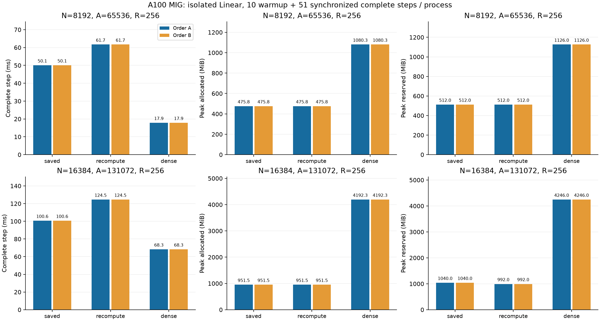

# Large-width response recomputation

**English** | [日本語](large-recompute-20261108.ja.md)

Compare saved responses and recomputation at R=256, square N=8192/16384,
A=8N on the same A100 MIG 3g.40gb allocation. The amplitude/radius law,
initialization, FP32 arithmetic, TF32-off policy and optimizer are unchanged.
The additional Algorithm declares the existing recomputation implementation
for the qualified large-square scope; it is benchmark-local and opt-in.
There is no new CUDA numerical code in this declaration.

Use the width study's verified frozen P/x/target/dY payloads, including its
N=2048 qualification payload. The prefix adapter checks the payload hash and
regenerated P/calibration before invoking the existing Linear worker. A fresh
committed source snapshot and independent extension build identify this study.
Run CUDA regressions, then N2048 recomputation correctness/optimizer checks.
Keep the runner's initial and updated full FP64 VJP checks at both large widths.

Two fresh processes per arm/width: A widths8192→16384, arms saved→recompute→Dense;
B widths16384→8192, arms Dense→recompute→saved. Each executes10 warmup and51 timed
complete synchronized steps. Include zero_grad, clearing dX, forward/MSE,
backward and optimizer; exclude setup, CPU proofs and result serialization.
Allocator peaks include all61 steps. Report allocated and reserved separately,
not total process memory. Reject failed correctness, nonfinite values, OOM and
timeout; stop on failure, preserve evidence and do not automatically retry.
Compare state hashes, retention-specific storage and all observations. There
is no long-training, full-LM quality, CUDA Graph or other-device claim.

Recomputation releases retained forward Z/H, but backward regenerates Z/H while
reverse intermediates remain live. For a single large Linear, transient peak
memory can therefore stay unchanged. This is a testable tradeoff, not an
assumed saving. A multilayer LM's previous result does not establish this peak.

The fixed protocol above was followed; audited results follow below.

## Working-storage accounting

For square charts, M=8 and direct levels2, one FP32 moment tensor uses
`Z_bytes = 4 R (N-2) (2M+1)` and one response uses `H_bytes = 4 R A`.
The gradient partials use `12 A ceil(R/8)` bytes and geometry uses `100 A`.
At N16384/A131072/R256 this is271.967MiB per Z,128MiB per H/G,
48MiB for partials and12.5MiB for geometry. Two orientations need about
860.434MiB for these tensors together, before inputs, outputs, gradients,
optimizer and owner metadata. Plain recomputation recreates the same working
set at backward peak. These are shape-derived tensor payloads, not measured
allocator peaks or total GPU process usage.

## Audited results

Numeric commit `73e6a51cb0ec92bf26f254d25e71c2f1300febf3`; 156 CPU/CUDA regression tests
passed. N2048 qualifications and every initial/updated large-width full VJP
check passed under the existing tolerances. Both reversed orders are retained.

| N | Arm | Step ms A / B | Allocated MiB A / B | Reserved MiB A / B |
| ---: | --- | ---: | ---: | ---: |
| 8192 | saved | 50.056 / 50.068 | 475.761 / 475.761 | 512 / 512 |
| 8192 | recompute | 61.680 / 61.681 | 475.761 / 475.761 | 512 / 512 |
| 8192 | dense | 17.858 / 17.853 | 1080.251 / 1080.251 | 1126 / 1126 |
| 16384 | saved | 100.641 / 100.640 | 951.511 / 951.511 | 1040 / 1040 |
| 16384 | recompute | 124.526 / 124.545 | 951.511 / 951.511 | 992 / 992 |
| 16384 | dense | 68.284 / 68.275 | 4192.251 / 4192.251 | 4246 / 4246 |

[Machine-readable results](large-recompute-20261108-results.json) retain original-result hashes
and final-state equality checks. Canonical local evidence: `output/large-recompute-20261108-01`.
Archive SHA256 `a09708ca61cb0479cf09ca276681e6df5c01bd22d04c96a63c5457e0e4fcd078`; 43 compact originals verified,
all owned controller/worker PIDs ended, frozen source/binary/input hashes checked.
Actual initial tensors were independently restored in the width study. Final
Parameter/gradient/Adam/clock hashes only; no final-state or raw oracle payload archive.
No public default or dispatcher adoption.

Plain recomputation is23.2% slower at N8192 and23.7–23.8% slower at N16384.
Allocated peak is identical to saved responses at both widths. Reserved peak
is unchanged at8192 and falls1040→992MiB at16384. Saved/recompute final state
hashes are exactly equal in both orders at both widths. It is not selected for
single-Linear peak-memory saving; windowed recomputation is a separate candidate.
