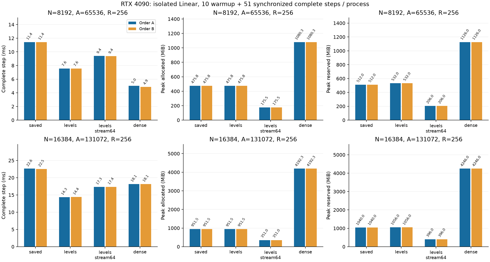

# RTX 4090での多入力Linear検証

[English](multirow-4090-20261108.md) | **日本語**

完了した[A100比較](multirow-levels-20261108.ja.md)を、使用許可されたRTX4090 24GBで
再現する。承認済みprofileと実GPU・compute capability8.9・メモリ・runtimeを確認する。
数値source095684f01f8527e190459529d05978abfd3f95beと、A100実験の実P/x/target/dYを
そのまま使う。kernel・初期化・LR・optimizer・Atom数・許容差・公開selector/既定値は変えない。

同じ対象CPU/CUDA回帰187件を実行し、両候補をN2048/A16384/R256で検証する。
全Y/dX/dPのCPU FP64 Fourier比較、profile求積、matched update、同勾配のoptimizer
wrapper検査を含む。失敗・OOM・非有限・timeoutで停止し、自動再試行せず証拠を残す。

続いてR256、正方N8192/16384、A8N、FP32 IEEE/TF32無効、q0/Xavier/minimum-001を
凍結常駐データで計測する。fresh processごとに既存Linear workerのwarmup10＋同期した
完全step計時51。zero_grad/dX消去・forward/MSE・backward/dX・optimizerを含む。
allocatorピークは全61更新を含み、準備・build・export・検証・hash化は別。
Graph・BF16・LM全体・大きな長方形FFNの測定は含まない。

A順は幅8192→16384、保存→levels→levels_stream64→Dense。
B順は幅16384→8192、Dense→levels_stream64→levels→保存。
全16観測、allocated/reserved、全51sample、初期・更新後全VJP、最終Parameter/勾配/
Adam/clock hashを保全する。4090内の同条件反復と最適化対保存のbyte一致を確認し、
GPU間一致は別に記録して普遍的bit一致を要求しない。各GPUでDense対照を実測する。
A100はMIG3g.40gbの結果で、フルA100ではない。GPU間で中央値を混ぜたり、hardwareに
依存しない高速化と推論したりしない。

専用cst-labディレクトリへ配置し、SM8.9拡張をそこでbuildする。通常のnohupで接続断に備え、
detach前にPID・command・log・outputを記録。終了まで監督し、hash照合した成果物を回収する。
server・無関係なprocess・元証拠を保全する。本書は実行前protocol。
後続LMスケール研究はmodel/data/token budgetを別途固定し、このjobでは学習を開始しない。

GPUホスト間の再現では、同じfixtureを構築した後に凍結Parameterと元校正reportを厳密復元する。
CPU命令セットで校正の末尾bitが変わる可能性があるため、現ホストでの再生成hash/reportは別記する。
既存input-prefix adapterによるCase全項目・P/report一致・入れ子x/target/dYの検査は維持。
worker loopと数値基準は変えず、復元driverの別commit/byte hashを残す。runtime算術の新設ではない。

## 監査済み結果

数値計算コミット`095684f01f8527e190459529d05978abfd3f95be`。CPU/CUDA回帰187件に合格。
N2048の検証と大規模各観測の初期・更新後全VJPも既存基準で合格した。両順序を保全する。

| N | Arm | Step ms A / B | Allocated MiB A / B | Reserved MiB A / B |
| ---: | --- | ---: | ---: | ---: |
| 8192 | saved | 11.432 / 11.430 | 475.761 / 475.761 | 512 / 512 |
| 8192 | levels | 7.557 / 7.554 | 475.761 / 475.761 | 532 / 532 |
| 8192 | levels_stream64 | 9.407 / 9.388 | 175.511 / 175.511 | 206 / 206 |
| 8192 | dense | 5.015 / 4.859 | 1080.251 / 1080.251 | 1126 / 1126 |
| 16384 | saved | 22.631 / 22.543 | 951.511 / 951.511 | 1040 / 1040 |
| 16384 | levels | 14.331 / 14.399 | 951.511 / 951.511 | 1056 / 1056 |
| 16384 | levels_stream64 | 17.339 / 17.362 | 351.011 / 351.011 | 396 / 396 |
| 16384 | dense | 18.128 / 18.139 | 4192.251 / 4192.251 | 4246 / 4246 |

[機械可読集計](multirow-4090-20261108-results.json)に元結果のhashと最終状態の一致判定を記録した。
canonical証拠：`output/multirow-4090-20261108-01`。archive SHA256：
`af2cd7954e02e2b039172ba8374f430ed01f8efef5192601e8f3d1a1fa69fa05`。57原本を照合し、所有controller/worker
PIDの終了、凍結source・binary・入力hashを確認。実初期Tensorは幅比較で独立復元済み。
最終状態はParameter/勾配/Adam/clockのhashのみで、最終状態payloadや生oracle Tensorは
archiveしていない。公開既定値・dispatcherへの採用は含まない。

N16384の`levels`は同じ4090のDenseより完全step時間が20.6–20.9%短く、
allocatedピークは22.7%。`levels_stream64`は時間が4.3–4.4%短く、allocatedは
8.37%（351MiB対4192MiB）。streamとDenseの小さい速度差は、この割当上の2順序に
限った観測であり、一般的に確立した速度差ではない。N8192はDenseの方が速い。
同sourceのsaved CSTと比べた`levels`の時間短縮は幅・順序により33.9–36.7%。

最終5状態（Parameter、勾配、Adamの1次・2次moment、clock）は4090内の
saved/levels/levels_stream64間と両順序でbyte完全一致。A100 MIGとの比較でもCSTの
全最終Tensor hashは一致した。実初期P/x/target/dYと凍結校正reportも両hostで一致。
一方、CPUで再生成したfixtureのP/reportはbyte一致せず、診断としてのみ記録して、
検証済み原本Pを明示復元した。DenseのCPU export初期Wと最終Tensor hashはhost間で
異なる。同じCPU Fourier演算によるexportだが、W Tensorを保存しておらずhost間の
数値差は定量化していない。DenseのGPU間byte一致やtrajectory比較は主張しない。
各device内のDense初期exportと繰り返し最終状態は一致。GPU間byte一致を合否条件には
しておらず、各GPUのCST初期・更新後全CPU FP64 VJPは既存数値基準で合格した。

実機はNVIDIA GeForce RTX4090、128SM、CC8.9、deviceメモリ25,262,096,384bytes。
Python3.12.9、Torch2.6.0+cu126、CUDA12.6、Triton3.2.0、CPU capability AVX2。
A100比較はMIG3g.40gbであり未分割A100ではない。各device自身のDense対照で判断し、
GPU間の中央値は混ぜない。4090 source archiveはA100と同hash：
`2215517190bd6240e7896d4c22965baf5d5afc3eaa936e1ff8c18522709fba03`。
別管理のreplay/protocol commitは`de90ad200d5b35d839c19f3e3e02b4284dfe4b9f`、
driver SHA256は`7fd82e8b687f6bb5043b83a7ef3cf1b39c4009803b16620b3d2aef5b683eb659`。
runtime算術は変更していない。adapterのCPU回帰は再生成初期値を意図的に変え、
原本復元・出自・CLI復元を確認する。controller PID725と所有subprocess22個は終了し、
serverや無関係jobは停止していない。未実行の最初のpayloadと採用payload-v2を両方保全。
build toolの導入はstudyディレクトリ内に隔離した。

別の[LM幅・全行列研究案](https://github.com/takumiecd/cst-research/pull/34)では、
FFN単独、QKV単独、併用から、O、共有語彙embedding/出力、学習位置embeddingへ累積して
追加し、まず幅512で検証する。大きな長方形・語彙射影・直接共有embedding lookupは
runtime対応と独立検証が学習前に必要。この単体Linear比較はLM実験の開始・完了ではない。
