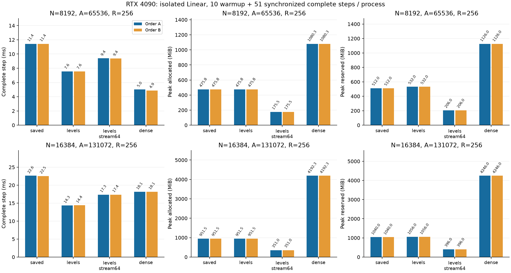

# RTX 4090 validation of multirow Linear

**English** | [日本語](multirow-4090-20261108.ja.md)

Repeat the completed [A100 comparison](multirow-levels-20261108.md) on the
user-authorized RTX4090 24GB. Verify the approved profile and actual GPU,
compute capability8.9, memory and runtime before work. Use the exact frozen
numeric source095684f01f8527e190459529d05978abfd3f95be and actual P/x/target/dY
payloads from the A100 study. No kernel, initialization, LR, optimizer, Atom
count, tolerance or public selector/default change.

Run the same187 targeted CPU/CUDA tests, then both N2048/A16384/R256 candidate
qualifications (full CPU FP64 Fourier Y/dX/all-dP, profile quadrature, matched
updates and same-gradient optimizer-wrapper checks). Stop on any failure, OOM,
nonfinite or timeout; preserve the failed run without automatic retries.

Then measure R256, square N8192/16384, A8N, FP32 IEEE/TF32 off, q0/Xavier/
minimum-001 with frozen resident data. Each fresh process executes the existing
Linear worker's10 warmup+51 synchronized complete timed steps, including
zero_grad/dX clearing, forward/MSE, backward/dX and optimizer. Allocator peaks
include all61 steps; setup/build/export/proofs/hashing are separate. No Graph,
BF16, full LM or large rectangular FFN measurement is implied.

OrderA: widths8192→16384, arms saved→levels→levels_stream64→Dense.
OrderB: widths16384→8192, arms Dense→levels_stream64→levels→saved.
Preserve all16 observations, both allocator metrics, all51 samples,
initial/updated full VJP checks and final Parameter/gradient/Adam/clock hashes.
Compare same-kind repeats and optimized-versus-saved byte equality within4090;
record cross-device equality separately without requiring universal bit equality.
Each GPU has its own Dense control. A100 numbers are MIG3g.40gb, not full A100.
Do not mix medians across devices or infer a hardware-independent speedup.

Deploy in an isolated cst-lab directory, build SM8.9 extensions there, and use
standard nohup to survive a client disconnect. Record PID/command/log/output
before detaching; supervise through completion and retrieve hash-verified
artifacts. Leave the server, unrelated processes and original evidence intact.
This protocol precedes execution. Subsequent LM scale studies need a separate
model/data/token-budget protocol; this job does not begin those training runs.

Cross-host replay restores the exact frozen Parameter values and original
calibration report after constructing the same fixture. Fresh CPU regeneration
hashes/reports are recorded separately, since CPU instruction sets may change
last-bit calibration. The existing input-prefix adapter still verifies all
frozen Case fields, P/report identity and nested x/target/dY; worker loops and
numerical tolerances remain unchanged. Record the replay driver's separate
commit/byte hash. It is orchestration, not new runtime arithmetic.

## Audited results

Numeric commit `095684f01f8527e190459529d05978abfd3f95be`; 187 CPU/CUDA regression tests
passed. N2048 qualifications and every initial/updated large-width full VJP
check passed under the existing tolerances. Both reversed orders are retained.

| N | Arm | Step ms A / B | Allocated MiB A / B | Reserved MiB A / B |
| ---: | --- | ---: | ---: | ---: |
| 8192 | saved | 11.432 / 11.430 | 475.761 / 475.761 | 512 / 512 |
| 8192 | levels | 7.557 / 7.554 | 475.761 / 475.761 | 532 / 532 |
| 8192 | levels_stream64 | 9.407 / 9.388 | 175.511 / 175.511 | 206 / 206 |
| 8192 | dense | 5.015 / 4.859 | 1080.251 / 1080.251 | 1126 / 1126 |
| 16384 | saved | 22.631 / 22.543 | 951.511 / 951.511 | 1040 / 1040 |
| 16384 | levels | 14.331 / 14.399 | 951.511 / 951.511 | 1056 / 1056 |
| 16384 | levels_stream64 | 17.339 / 17.362 | 351.011 / 351.011 | 396 / 396 |
| 16384 | dense | 18.128 / 18.139 | 4192.251 / 4192.251 | 4246 / 4246 |

[Machine-readable results](multirow-4090-20261108-results.json) retain original-result hashes
and final-state equality checks. Canonical local evidence: `output/multirow-4090-20261108-01`.
Archive SHA256 `af2cd7954e02e2b039172ba8374f430ed01f8efef5192601e8f3d1a1fa69fa05`; 57 compact originals verified,
all owned controller/worker PIDs ended, frozen source/binary/input hashes checked.
Actual initial tensors were independently restored in the width study. Final
Parameter/gradient/Adam/clock hashes only; no final-state or raw oracle payload archive.
No public default or dispatcher adoption.

At N16384, `levels` reduces complete-step time by20.6–20.9% versus the
same-device Dense control, with22.7% of its allocated peak. `levels_stream64`
reduces time by4.3–4.4%, with8.37% of Dense's allocated peak (351MiB versus4192MiB).
The small stream-versus-Dense timing advantage is specific to these two orders
on this allocation; it is not a generally established speed margin. At N8192,
Dense remains faster. Versus the same-source saved CST route, `levels` reduces
time by33.9–36.7%, depending on width/order.

All five final Tensor states (Parameter, gradient, Adam first/second moment and
clock) match byte-for-byte between saved/levels/levels_stream64 and across both
orders within4090. Cross-device auditing also finds all CST final Tensor hashes
identical to A100 MIG. Actual initial P/x/target/dY and frozen calibration reports
match on both hosts. Fresh CPU fixture regeneration does not produce identical
P/report bytes, so it is recorded only as a diagnostic; the verified original P
is explicitly restored. Dense's CPU-exported initial W hashes and final Tensor
hashes differ across hosts. The export uses the same CPU Fourier operator, but
without archived W tensors the cross-host numeric difference is not quantified;
do not claim cross-device Dense bit identity or use it as a trajectory comparison.
Within each device both Dense initial exports and repeated final states match.
Cross-GPU bit identity was not a qualification gate; every CST initial/updated
full CPU FP64 VJP passed the existing numerical gates on each GPU.

Actual hardware: NVIDIA GeForce RTX4090,128SMs,CC8.9,25,262,096,384 bytes device
memory; Python3.12.9,Torch2.6.0+cu126,CUDA12.6,Triton3.2.0,CPU capability AVX2.
The A100 comparison is MIG3g.40gb, not an unsliced A100. Each device's own Dense
control is authoritative; do not pool cross-device medians. The final4090 source
archive hash matches A100 (`2215517190bd6240e7896d4c22965baf5d5afc3eaa936e1ff8c18522709fba03`).
The separate replay/protocol commit is `de90ad200d5b35d839c19f3e3e02b4284dfe4b9f`,
driver SHA256 `7fd82e8b687f6bb5043b83a7ef3cf1b39c4009803b16620b3d2aef5b683eb659`.
No runtime arithmetic changed. The replay adapter's CPU regression deliberately
perturbs fresh initialization and checks frozen restoration, provenance and CLI
restoration. Controller PID725 and22 owned subprocesses ended; server/unrelated
jobs were not stopped. The never-executed first payload and selected payload-v2
are both preserved. Build-tool installation was isolated to this study directory.

The proposed [LM width and all-matrix study](https://github.com/takumiecd/cst-research/pull/34)
is separate: FFN-only, QKV-only, combined, then cumulative O, tied vocabulary
embedding/output and learned position embedding, first qualified at width512.
Large rectangular operators, vocabulary projection and direct tied embedding
lookup need runtime support/qualification before training. This Linear validation
does not start or complete that LM study.
