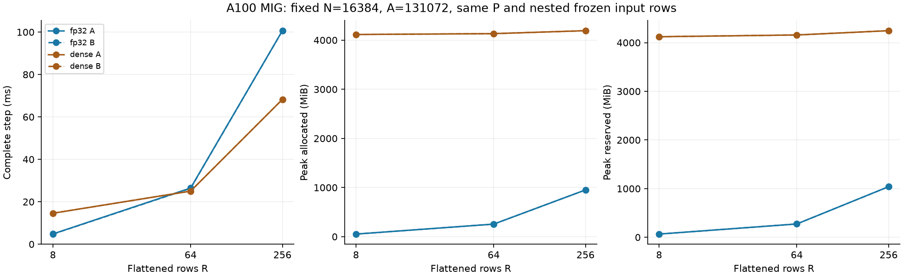
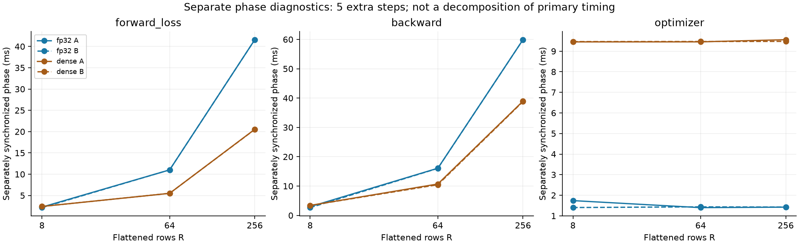

# 入力行数だけを変える比較

[English](multirow-batch-20261108.md) | **日本語**

残る性能差でbatchが支配的かというユーザーの問いを確認する。Linearで効くRは
FFNの場合batch×tokenの平坦化した行数である。R256固定の幅比較だけではRの影響は特定できない。
N=16384・A=131072を固定し、R=8/64/256で初期Parameterと凍結x/target/dYの同じ先頭行を使う。
minimum-001/q0/Xavier、lr1e-4/decay0、FP32 IEEE/TF32 off、A100 MIG3g.40gbは同じ。

数値sourceとcompiled extensionは幅比較のimmutable3dd8115dを維持する。
input_prefix orchestrationはpayload SHA256、再生成したP・分散合わせreport、id/rows以外の
全Case項目を検証し、既存Linear workerを呼ぶ。変えるのはデータの選択で、学習・計時loopではない。
driverのGit commit・byte hashは数値sourceと分けて残す。

CST FP32並列とDenseをfresh processで比較する。A順は行数8→64→256、各CST→Dense。
B順は行数256→64→8、各Dense→CST。各観測はwarmup10＋primary計時51で、61更新全部が
allocator peak対象。データ常駐、zero_grad・dX消去・F/MSE/B・optimizerを含む。
その後、forward/loss・backward・optimizerを個別同期する診断を5更新追加する。
別の計装結果であり、medianを足し引きしてprimary時間を求めない。
primary state hash・peakは診断前（clock61）で、実際のprocessは66更新を実行する。

CST workerでは既存の初期・更新後の全Atom FP64 Fourier VJP検証を維持する。
source/GPU資格は幅比較を再利用し、そのR1/9/256境界・端数と全R256/A8N検証に続く比較である。
初期データ相違、数学検証不合格、nonfinite、OOM、時間上限で止め、失敗を保全する。
全12観測、primary51sampleと診断5sample、allocator peak、初期化・radius分布を比較する。
根拠なくRの影響を単一kernelへ帰属したり、この更新から精度・収束を判断したりしない。
公開default・Graph・別GPU・Atom/LR/カーネル則のsweepは含めない。

## 監査済み結果

数値計算ソース`3dd8115d09251146d9fbdc8876f9a7dc99b61f01`、driverは
`5ae3d264`（完全コミットは集計）。独立12計測すべて合格。初期P・校正・入れ子の
入力prefix・Denseの初期有効Wは一致し、全行数・条件の最終Parameter/勾配/
Adam/clockハッシュは両順序で完全一致した。

| R | Arm | Step ms A / B | Allocated MiB A / B | Reserved MiB A / B |
| ---: | --- | ---: | ---: | ---: |
| 8 | fp32 | 4.838 / 4.769 | 52.510 / 52.510 | 66 / 66 |
| 8 | dense | 14.593 / 14.600 | 4114.751 / 4114.751 | 4122 / 4122 |
| 64 | fp32 | 26.470 / 26.340 | 255.511 / 255.511 | 274 / 274 |
| 64 | dense | 25.025 / 25.031 | 4132.251 / 4132.251 | 4158 / 4158 |
| 256 | fp32 | 100.654 / 100.634 | 951.511 / 951.511 | 1040 / 1040 |
| 256 | dense | 68.266 / 68.275 | 4192.251 / 4192.251 | 4246 / 4246 |

R8ではCSTが3.02〜3.06倍速い。R64ではDenseの1.052〜1.058倍の時間、R256では
1.474倍の時間を要する。幅・Atom数を固定しても行数で残りの性能差が変わる。
小RでもDenseのoptimizerはN²個のParameterを更新するが、CSTのParameter・更新
payloadはAに比例する。Rが増えるとDenseのoptimizerの固定費を償却できる一方、
CSTのprojection/expansion/勾配の仕事は増える。これは一つの幅・allocationの
観測であり、交差点を与える定理ではない。

R256・A順序の別計測中央値はforward/loss41.59ms、backward59.91ms、optimizer1.42ms。
調べるphaseの特定には使えるが、その和は主計測の完全step時間ではない。
[集計](multirow-batch-results-20261108.json)に全観測・診断sample・元結果のハッシュを残した。

試行01はCLI adapterのTypeErrorで計時前に停止し、remoteにログを保全した。
引数なしCLIの実際のsignatureと、sys.argv/fixture/metadataの復元を回帰テストで確認する。
試行02はcanonical `output/large-multirow-batch-20261108-02`に独立保全。
archive SHA256：`270b61247703d8f0a48076cdc76b9c8af53ec0bff58e3cc082497e96ddbb8b62`。
40原本をdownload・hash照合し、所有14 PIDの終了を確認。元source/extensionsと親入力
payloadハッシュも再確認した。実初期Tensorは幅比較で復元済み。最終状態はハッシュのみで、
生のoracle Tensorはarchiveしていない。公開既定値は変更していない。
