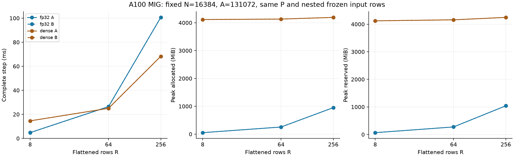
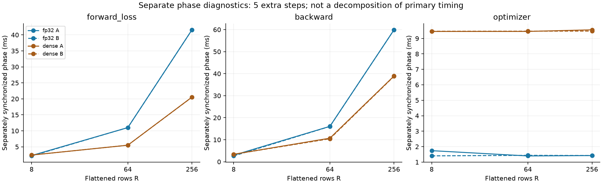

# Controlled input-row comparison

**English** | [日本語](multirow-batch-20261108.ja.md)

The user asked whether batch size dominates the remaining performance gap.
For Linear, the relevant R is the flattened row count (batch×tokens in an FFN).
The R256 width comparison alone cannot identify an R effect. Hold N=16384 and
A=131072 fixed, and compare R=8,64,256 using identical initial Parameters and
matching leading rows of frozen x/target/dY. Use the same minimum-001/q0/Xavier
fixture, lr1e-4/decay0, FP32 IEEE/TF32 off and A100 MIG3g.40gb allocation.

The numeric source and compiled extensions remain the immutable3dd8115d width
study. The input_prefix orchestration verifies the input payload SHA256,
regenerated P/calibration, and every frozen Case field except id/rows, then
calls the existing Linear worker. It changes data selection, not a training or
timing loop. Record its Git commit and byte hash separately from numeric source.

Fresh processes for CST FP32-parallel and Dense: A runs rows8→64→256 with
CST→Dense; B rows256→64→8 with Dense→CST. Each has10 warmup+51 primary timed
steps, all61 in allocator peaks. Resident data; zero_grad/dX clearing, F/MSE/B,
optimizer included. Five additional synchronized forward/loss, backward and
optimizer diagnostic steps run afterwards. They are separate instrumentation:
never sum/subtract their medians to derive primary time. Primary state hashes
and peaks precede those five steps (clock61); actual process executes66 steps.

Existing initial/updated all-Atom FP64 Fourier VJP checks remain active in CST
workers. Source/GPU qualification is reused from the width study; its R1/9/256
index/tail tests and fullR256/A8N checks precede this comparison. Reject changed
initial data, failed math, nonfinite, OOM or timeout; preserve failures. Compare
all12 observations, all51 primary samples and all5 diagnostic samples, allocator
peaks, initialization and radius distributions. Do not attribute an R effect to
one kernel without evidence or infer accuracy/convergence from these updates.
No public default, Graph, other hardware, Atom/LR/kernel-law sweep is included.

## Audited results

Numeric source `3dd8115d09251146d9fbdc8876f9a7dc99b61f01`, driver
`5ae3d264` (full commit in aggregate). All12 fresh measurements passed. Initial
P/calibration, nested input prefixes and Dense's effective initial W matched.
Final Parameter/gradient/Adam/clock hashes matched exactly between both orders
for every row count and arm.

| R | Arm | Step ms A / B | Allocated MiB A / B | Reserved MiB A / B |
| ---: | --- | ---: | ---: | ---: |
| 8 | fp32 | 4.838 / 4.769 | 52.510 / 52.510 | 66 / 66 |
| 8 | dense | 14.593 / 14.600 | 4114.751 / 4114.751 | 4122 / 4122 |
| 64 | fp32 | 26.470 / 26.340 | 255.511 / 255.511 | 274 / 274 |
| 64 | dense | 25.025 / 25.031 | 4132.251 / 4132.251 | 4158 / 4158 |
| 256 | fp32 | 100.654 / 100.634 | 951.511 / 951.511 | 1040 / 1040 |
| 256 | dense | 68.266 / 68.275 | 4192.251 / 4192.251 | 4246 / 4246 |

At R8 CST is3.02–3.06× faster, at R64 it takes1.052–1.058× Dense's time,
and at R256 it takes1.474×. Thus row count materially changes the remaining gap
at fixed width/Atom count. Dense's optimizer still updates its N² Parameters
at small R; CST's parameter/update payload scales with A. Larger R amortizes
Dense's optimizer while increasing the CST projection/expansion/gradient work.
This is an observation at one width and allocation, not a crossover theorem.

At R256, orderA separate diagnostic medians are41.59ms forward/loss,59.91ms
backward and1.42ms optimizer. These identify the phases to investigate; their
sum is not the primary complete-step time. [The aggregate](multirow-batch-results-20261108.json)
retains all observations, diagnostic samples and original-result hashes.

Attempt01 stopped before timing with a CLI adapter TypeError. Its logs remain
remote; a regression now checks the real zero-argument CLI signature and restores
sys.argv/fixture/metadata after invocation. Attempt02 is independently preserved
in canonical `output/large-multirow-batch-20261108-02`. Archive SHA256:
`270b61247703d8f0a48076cdc76b9c8af53ec0bff58e3cc082497e96ddbb8b62`.
All40 compact originals were downloaded and hashed; all14 owned PIDs ended.
Original source/extensions and parent input payload hash were rechecked.
Actual initial tensors were restored in the parent width study; final-state
hashes only and no raw oracle tensors are archived. No public default changed.

