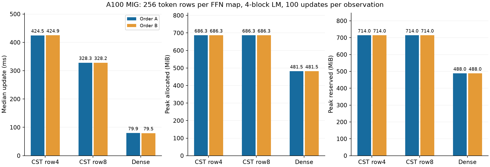
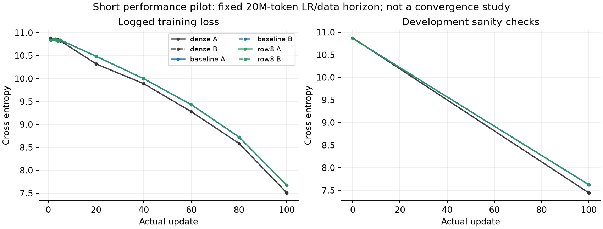

# 多入力FFNの計算共有pilot

[English](multirow-ffn-20261107.md) | **日本語**

## 契約と候補

既存の256行・256→1024／1024→256 FFN、各map A4096、
Polar modes8/base1/merge2/spacing1を対象とする。
既存active-nativeのFP64 moment経路を対照に、別登録の研究Algorithm
`cuda_radius_cell_mass_row8/v1`で出力展開・Parameter勾配の幾何計算を
4行から8行へ共有する。明示的な`ROW8_NATIVE` Planは既存active-native recipeを使う。
production catalog/defaultには登録しない。

CPU宣言とnative checked入口の検査を維持する。
source hashとbuild suffixで候補binaryを区別し、default buildは4行のままとする。
候補はbaselineの専用execution programを使わず、generic dispatchを用いる。
Tensor/function変換時は既存Python入口へfallbackする。
今回は演算共有だけのpilotで、FP64 Z/H/G、保存Tensorの所有・version検査、支持、
radiusのtask微分のdetach、正規化、Atom数・形状、初期化、更新則を維持する。
8行の端数maskで全入力行を保持し、Atom勾配の最終batch縮約は元の昇順を保つ。
shared-memory配置を共有行数に合わせて計算する。資源負担増で遅くなる可能性もある。

## GPU計時前に固定するgate

1. CPUのmetadata・support・直列化・経路選択と既存nativeの回帰確認。
2. A100 MIG3g.40gbで実Torch/CUDAを記録する。非連続な2×128 token入力で、
   FFN両方向のY・dX・全Atom勾配をchunk化したCPU FP64 Fourier/autograd参照と比較。
   既存atol3e-5/rtol3e-4を維持する。共有Fourier数式は独立polynomial求積で補う。
   周期境界、狭い・広い支持、ゼロ振幅、端数行、retained backward/version検査を確認し、
   Graph/captureは未対応として拒否する。
3. 既存CUDAと出力・勾配、optimizerのParameter・moment・clockを比較し、
   実4block FFN taskでresumeを確認する。完全一致と許容差合格を区別し、許容差は緩めない。
4. 正しさ合格後のみ、既存cst-research FFN learnerで旧経路・row8・Denseをfresh process比較。
   pre-LN4block、幅256、FFN展開4、head4、c8、q0、minimum-001 envelope、
   native finite_chord更新、Atom LR16倍、baseLR3e-4、AdamW(.9,.95)、decay0、
   clip1、TF32off、seed17。batch2/context128/accumulation4で1回256行、1更新1024token。
   data/LR horizon20M token固定、100実更新（102400token）、developmentのみ。
   計時内にprobeを入れず、転送・全microstep・更新を含む。
   順序Aは旧経路→Dense→row8、順序Bはrow8→Dense→旧経路。
   同一allocation内の2つのfresh-process観測で、6台の独立GPU再現ではない。
5. 同期した完全更新sample、別枠の準備、model・optimizer常駐とeager一時領域を含む
   peak allocated/reservedを報告する。Graph/captureやprocess全使用量は主張しない。
   CST間は全modelの初期Parameterと分散合わせreportを比較する。
   Denseは通常の分散互換初期化であり、CSTと同じ行列ではない。

資格検証失敗・OOM・nonfinite・時間予算で固定試行を停止する。
負の結果と実source/result hashを保持する。
正しさ合格だけで採用せず、メモリと完全step時間で判断し、残るDense差も報告する。
短期性能pilotであり、長期学習精度・最小Atom数・他GPU性能は示さない。
4090は使用しない。raw evidenceはignored outputに保全する。

上記は計時前に固定したprotocolであり、以下に完了結果を示す。

## 完了したA100結果

**両順序で完全更新時間を22.67〜22.75%短縮し、allocated/reserved peakは維持した。
Denseはなお約4.11〜4.13倍速く、ピークメモリも小さい。**
A100研究用opt-inとしての結果であり、Denseメモリ目標やproduction defaultの達成ではない。

GPUはNVIDIA A100 80GB PCIe MIG 3g.40gb、CC 8.0、PyTorch 2.6.0+cu126、
CUDA 12.6、Python 3.12.9。
単一Linear kernelではなく、FFN全8mapを置換した4block LMの更新である。
各順序・各条件100更新、合計600更新を実行した。既存learnerの計時sampleは
更新11〜100の90個。メモリには100更新全部を含む。zero_grad・LR設定は計時前、
転送・4microstep・forward/loss/backward・clip・optimizerは計時内。
準備はlearnerが報告するsetupで、資格検証・cold build、評価・checkpoint・最終probeとは別。
両順序のpeakは一致した。

| Implementation | Update ms (A / B) | Allocated MiB | Reserved MiB | Setup s (A / B) |
| --- | ---: | ---: | ---: | ---: |
| baseline | 424.539 / 424.896 | 686.281 | 714 | 26.64 / 27.38 |
| row8 | 328.301 / 328.228 | 686.281 | 714 | 26.00 / 29.49 |
| dense | 79.897 / 79.531 | 481.501 | 488 | 1.52 / 1.63 |



数値検証はA100で対象39件pass（端数・境界・逆伝播再実行のGPU10件を含む）。
FFN両方向で全4096 Atom勾配・Y・dXを既存FP64 Fourier/autograd基準と照合し、
独立polynomial求積でも補完した。最大絶対誤差はY1.152e-7、dX1.182e-7、
dP1.904e-6で、旧経路・row8とも同じ最大値だった。
実taskの3更新では勾配・Parameter・Adam Tensorがbyte一致した。
4つのCST観測の初期Parameter・分散合わせreportも一致。
100更新後は各順序で旧経路とrow8のモデル・optimizer392 Tensorのhashが一致し、
同じ種類の順序間でも一致した。これはremoteでTensor bytesをhash化した比較であり、
未記録の全途中状態やcheckpoint file全体のbytes一致の主張ではない。
実task再開のParameter最大差は0。localCPU一式2160pass/2501skipは最終GPU fixture
修正より前のheadで、skipしたGPU対象は別途A100で検証した。



CSTの記録済み曲線は重なる。最終DEV CEは両CST7.62488024、Dense7.44457933。
20M-token horizonのwarmup途中100更新の性能pilotであり、収束やDenseとの学習精度
同等性を示す実験ではない。FP64 moment/responseの保存を維持したため、メモリ削減はない。
この保存領域の削減を次の独立した最適化対象とする。

対応するFFN層で明示的に選択できる：

```python
from torchcst import FixedSelector, make_algorithm_registry
from torchcst._backends.cuda.algorithms.linear.radius_cell_mass.row8 import (
    ROW8_NATIVE, RadiusRow8Algorithm,
)
registry = make_algorithm_registry()
registry.register(RadiusRow8Algorithm())
layer.selector = FixedSelector(ROW8_NATIVE, registry=registry)
```

private研究Planは宣言した形状・A4096・FP32・1〜256行に限定する。
共有8行とmodes8は別の設定である。model checkpointは数値状態を保存し、selectorは
保存しない。固定wrapperと同様、復元時もPlanを記録・再設定する。
Graph/captureや他GPUは未検証。候補は研究branch/PRに保全し、公開defaultは維持する。

固定snapshotはa4ef6af7a94ead722c137ed16f52342715f55120。
immutable attempt02/3c3f0050のruntime sourceを使い、修正したGPU test以外はbyte一致。
consumerはac64f6db4fdf616870c41fed779e1119ecc5e441。
先の2試行はfixture必須引数とnative ReadLeaseエラー文言で停止し、数値許容差や
kernel算術は変更していない。完了試行のsource archive SHA256は
`318faff6143ca71fc2eb18a540448bd790a4e16963687011069af560d82b4e59`。
compact原本SHA256は`b045d4ef1989a724d2c88fda1b1dcbafd8a843291715e728abd2e2820d395e4e`、198558bytes、56原本を検証。
rawと再現・orchestration scriptはcanonicalのignored
`output/multirow-ffn-20261107-01/02/03`へ保全した。
checkpoint原本は元のA100各ディレクトリにあり、SHA256はcomparison.jsonにある。
compactには資格検証のmetric・assertionとTensor hashを収録し、oracleの生Y/dX/dPや
checkpoint payloadは含めない。localでoracleを再計算したとは主張しない。
postflightで所有controller/child16 PIDの終了を確認した。
binary hashはpostflight.jsonのbuild原本で、各processの実loaded libraryを独立採取した
記録ではない。4090・pool job・他serverは変更していない。

続報：[多入力FP32化の時間・メモリ比較](multirow-packed-20261107.ja.md)。
