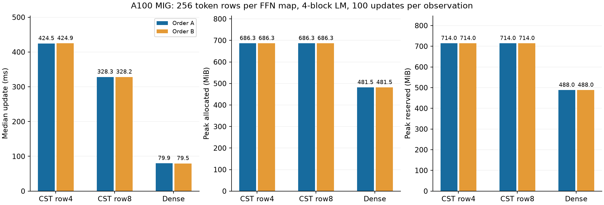
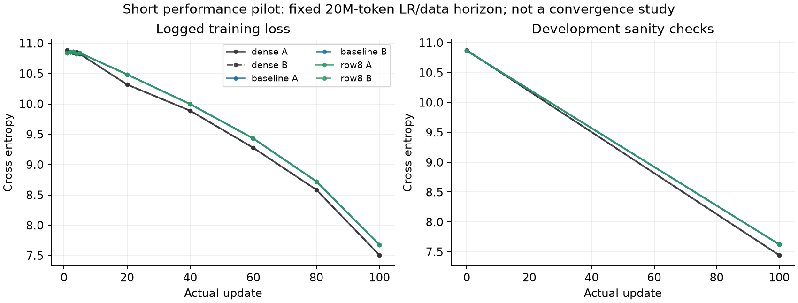

# Multirow FFN reuse pilot

**English** | [日本語](multirow-ffn-20261107.ja.md)

## Contract and candidate

Optimize the existing 256-row, 256→1024 / 1024→256 FFN, A4096 per map,
Polar modes8/base1/merge2/spacing1. The existing active-native FP64-moment path
is the baseline. A separately registered research Algorithm,
`cuda_radius_cell_mass_row8/v1`, shares expansion and parameter-gradient geometry
across eight rows instead of four. The explicit `ROW8_NATIVE` Plan uses the
unchanged active-native recipe. It is not in the production catalog/default.

The CPU declarations and existing native checked entry retain their validation.
The candidate's source hash and build suffix distinguish its binary; default
builds still use four rows. It uses generic dispatch rather than the baseline's
specialized execution program. Tensor/function transforms fall back to the
existing Python entrance. This is an arithmetic-reuse pilot: FP64 Z/H/G, saved
Tensor ownership/version checks, support, detached radius task derivatives,
normalization, Atom count/shape, initialization and update law are unchanged.
Eight-row tail masks retain every input row and the original increasing batch
order in the final Atom-gradient reduction. Shared-memory layout is computed
for the selected group width; higher resource pressure can make it slower.

## Gates fixed before GPU timing

1. CPU metadata/support/serialization/selection and existing native regressions.
2. A100 MIG3g.40gb, record actual Torch/CUDA. Full 2×128 token inputs with
   noncontiguous layout: Y, dX and every Atom gradient in both FFN directions
   against the chunked CPU FP64 Fourier/autograd reference. Preserve the existing
   atol3e-5/rtol3e-4 admission. The independent polynomial quadrature check
   supplements the shared Fourier mathematics. Cover periodic edges, small and
   large support, zero amplitude, tail rows, retained backward/version checks,
   and reject Graph/capture rather than assuming support.
3. Compare candidate with current CUDA for outputs/gradients and optimizer
   Parameters/moments/clocks; test resume on the actual four-block FFN task.
   Record exactness separately from tolerance admission. No tolerance relaxation.
4. Only after correctness passes, run the existing cst-research FFN learner in
   fresh processes for baseline, row8 and Dense. Four pre-LN blocks, width256,
   FFN expansion4, head count4, c8, q0, minimum-001 envelope, native finite_chord
   update, Atom LR16×, baseLR3e-4, AdamW(.9,.95), decay0, clip1, TF32off, seed17.
   Batch2/context128/accumulation4 =256 rows per invocation and1024 tokens/update.
   Fixed20M token data/LR horizon,100 real updates (102400tokens), development
   only. No probes in timing; data transfer and all microsteps/updates are timed.
   Order A: baseline,Dense,row8; order B: row8,Dense,baseline. These are two
   fresh-process observations in one allocation, not six independent GPUs.
5. Report synchronized complete-update samples, setup separately, peak allocated
   and reserved including resident model/optimizer and eager temporaries. No
   Graph/capture or total process-memory claim. Compare full-model initial
   Parameters and calibration reports across the CST arms. Dense has its normal
   variance-compatible initialization; it is not an identical CST matrix.

Stop the frozen attempt on qualification failure/OOM/nonfinite/time budget.
Preserve negative results and actual source/result hashes. The candidate is not
adopted merely for passing correctness: judge complete-step time together with
memory; report remaining Dense gaps. This short performance pilot does not
establish long-run learning quality, minimum Atom counts or other GPU behavior.
RTX4090 is unavailable for this task. Raw evidence stays in ignored output.

The protocol above was fixed before timing; completed results follow.

## Completed A100 result

**The candidate reduced complete-update time by 22.67–22.75% in both orders,
with unchanged allocated/reserved peaks. Dense remains about 4.11–4.13× faster
and uses less peak memory.** This qualifies an explicit A100 research opt-in,
not the Dense memory objective or a production default.

GPU: NVIDIA A100 80GB PCIe MIG 3g.40gb, CC 8.0, PyTorch 2.6.0+cu126, CUDA 12.6, Python 3.12.9.
These are whole four-block LM updates with all 8 FFN maps replaced, not single
Linear kernel timings. Both orders executed 100 updates per arm (600 total).
The existing learner retains 90 timing samples, updates 11–100. All 100 updates
enter peak memory. Zero-grad/LR assignment precedes the clock; transfer,
four microsteps, forward/loss/backward, clipping and optimizer are inside it.
Setup is the learner's reported setup; qualification/cold builds, evaluation,
checkpoint writes and final probes are separate. Peaks matched between orders.

| Implementation | Update ms (A / B) | Allocated MiB | Reserved MiB | Setup s (A / B) |
| --- | ---: | ---: | ---: | ---: |
| baseline | 424.539 / 424.896 | 686.281 | 714 | 26.64 / 27.38 |
| row8 | 328.301 / 328.228 | 686.281 | 714 | 26.00 / 29.49 |
| dense | 79.897 / 79.531 | 481.501 | 488 | 1.52 / 1.63 |



Numerical admission: 39 targeted tests passed on A100, including 10 GPU edge/tail/
retained-backward tests. In both full FFN directions all 4,096 Atom gradients,
Y and dX passed the unchanged FP64 Fourier/autograd gate plus the independent
polynomial-quadrature supplement. Maximum absolute errors were 1.152e-7 (Y),
1.182e-7 (dX), and 1.904e-6 (dP), the same maxima for baseline and row8.
Three full-task updates had byte-exact gradients, Parameters and Adam tensors.
All 4 CST observations had identical initial Parameters/calibration reports.
At 100 updates the 392 model/optimizer Tensor hashes matched baseline versus row8
in each order; same-kind observations also matched across orders. This is a
remote Tensor-byte hash comparison, not a claim that every unlogged intermediate
or every checkpoint file byte is identical. Actual-task resume had 0 maximum
Parameter error. Local CPU suite: 2,160 passed / 2,501 skipped preceded final GPU-only fixture
fixes; those skipped GPU tests were separately qualified on A100.



The logged CST curves overlap. Final DEV CE was 7.62488024 for both CST routes
and 7.44457933 for Dense. This is a 100-update warmup-stage performance pilot with
a 20M-token horizon; it establishes neither convergence nor Dense/CST quality
equivalence. FP64 moments/responses are still retained, explaining the lack of
a memory reduction. Reducing that storage is the next separate optimization.

The narrow Plan can be selected explicitly on an admitted FFN layer:

```python
from torchcst import FixedSelector, make_algorithm_registry
from torchcst._backends.cuda.algorithms.linear.radius_cell_mass.row8 import (
    ROW8_NATIVE, RadiusRow8Algorithm,
)
registry = make_algorithm_registry()
registry.register(RadiusRow8Algorithm())
layer.selector = FixedSelector(ROW8_NATIVE, registry=registry)
```

This private research Plan requires the declared shapes/A4096/FP32 and 1–256
rows. Eight shared rows and modes8 are different settings. The existing model
checkpoint stores numerical state, not this selector: record/reapply the Plan
when restoring, as done by the frozen selector wrapper. Graph/capture and other
GPUs remain unqualified. The candidate is kept on its research branch/PR;
public default selection is unchanged.

Frozen snapshot:a4ef6af7a94ead722c137ed16f52342715f55120; runtime source from
immutable attempt02/3c3f0050 is byte-equal except the corrected GPU test.
Consumer:ac64f6db4fdf616870c41fed779e1119ecc5e441. The first two attempts stopped
on required fixture arguments and native ReadLease error wording; no numerical
tolerance or kernel arithmetic was changed. Completed source archive SHA256:
`318faff6143ca71fc2eb18a540448bd790a4e16963687011069af560d82b4e59`.
Compact results SHA256:`b045d4ef1989a724d2c88fda1b1dcbafd8a843291715e728abd2e2820d395e4e`,198,558 bytes, 56 verified original
files. Raw evidence and orchestration/reproduction scripts are preserved in
canonical ignored `output/multirow-ffn-20261107-01/02/03`; exact checkpoint files
remain in the original A100 directories with SHA256 in comparison.json.
The compact archive includes qualification metrics/assertions and Tensor hashes,
not raw oracle Y/dX/dP or checkpoint payloads; no local oracle recomputation is
claimed. The postflight verified all 16 owned controller/child PIDs inactive.
Runtime binary hashes are in postflight.json; they describe postflight build
artifacts, not independently captured per-process loaded-library identities.
No RTX 4090/pool jobs or unrelated servers were changed.

Follow-up: [FP32 multirow time/memory study](multirow-packed-20261107.md).
