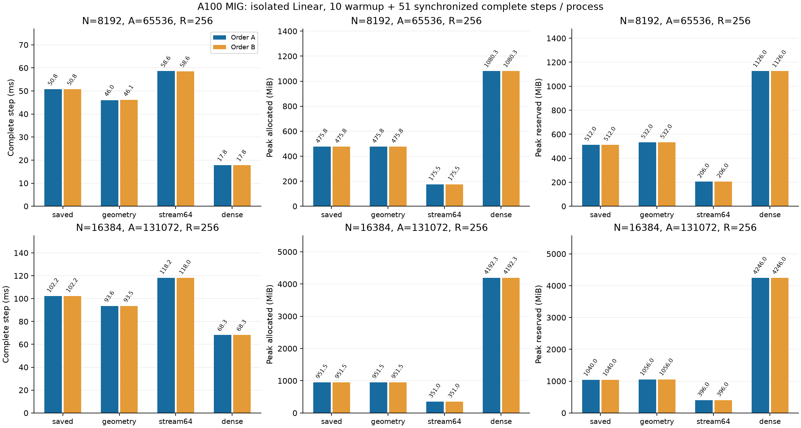

# トークン行をまたぐAtomごとのgeometry再利用

[English](multirow-geometry-20261108.md) | **日本語**

N16384の行数対照実験の最初の順序では、大きいRの時間はoptimizerより
forward/backwardが支配した。R256の別計測中央値はforward+loss/backward/
optimizerで41.59/59.91/1.42ms（足したり引いたりして主計測を構成しない）。
コード上、projectionとexpansionは同じ半径・wrapした中心・Fourier係数9個を
8行ごとにdecodeし、backwardでも再実行している。

候補`cuda_radius_large_multirow_geometry`は既存のFP32・25値/Atomのgeometryを
forwardごとに一度だけ計算し、projection・expansion・勾配の各groupでbackward
まで再利用する。そのautograd呼出しが入力・Parameterと通常のversion検査付きで
保持する。Algorithm上のcache、CPUへのAtom読出し、数式・Polar・LRの変更、
dense W/dWはない。追加forward保持は100A byte（N8192/16384で6.25/12.5MiB）。
従来もbackwardに同じ一時tableを作るため、保持が無料と仮定せずピークを測る。

既存の保存・再計算経路も選択可能に保つ。既定値・Tensor変換fallback・一次微分
制限・旧scopeは維持し、新templateも既定は旧経路。半径変化・周期画像・R1/9/256
端数・大きいowner key・非連続入力・片側だけの勾配・saved hook・retain backward・
古いParameterの拒否を確認する。性能の前に既存CPU FP64/独立求積/matched-state
基準で全N2048/A8NのY/dX/dPとoptimizerを検証する。

R256/N8192/16384/A8Nで幅比較の凍結初期値・データを使う。既存workerのwarmup10＋
計測51の同期した完全step、allocatorピークは全61更新。fresh processで両順序：
Aは8192→16384、保存→geometry→stream64→Dense、Bは16384→8192、Dense→stream64→geometry→保存。
演算・勾配・Adam・Parameter基準と初期・更新後全VJPを維持。失敗を残し、基準違反・
OOM・非有限・timeoutで停止。独立source/buildを使い、GPU実験は同時実行しない。
同条件の両順序の最終hashを確認し、geometryと保存のbyte一致は、事前計算による
コンパイラの丸め差もあり得るため仮定せず記録する。公開・既定採用は別の判断とする。

上記は計測前に固定した仮説とprotocolである。結果を以下に記す。

## 窓単位の再計算候補（GPU計測前に固定）

`cuda_radius_large_multirow_stream64`はx/P・owner key・同じgeometry tableのみ保持する。
forwardは64行ずつYへ出力し、backwardは64行ずつmomentと応答を再生成する。
ceil(R/8)×A×3のFP32勾配partial全体を保持し、最後に従来と同じ8行group順で一度だけ
reduceする。窓ごとにreduceしたdPを足す方式にはしない（加算順が変わるため）。
両向きの処理・forward射影の再計算・Y/dXへの窓コピーは完全stepの計時に含む。
R256ではZ/H/G作業領域が256行分から64行分になるが、全x/Y/dXとpartial tableは残る。
Atom数・Parameter・更新状態・batch lossの尺度は変更しない。R1/9/256に加えてR65、
両候補の片側勾配・retain backward・version検査を確認する。両候補をN2048で検証してから、
大規模16観測を実施する。保存・geometry・streamの最終hash一致は仮定せず記録する。
公開checkpoint APIや既定値の採用ではない。

stream64のR256/N16384/A131072では両向きZ/H/Gが合計約199.983MiBになり、
全partial table48MiBとgeometry12.5MiBは残る。shapeから求めた中心的な作業領域は
860.434MiBから260.483MiBになる。入力・出力・optimizer・owner metadataは別で、
実現した節約はallocatorピークで判定する。loss/dYは全Rで求めたものを維持するため、
窓への分割でbatch lossの正規化やoptimizer更新頻度は変えない。

## 監査済み結果

数値計算コミット`4f4a446124bd68fc2683ccac16e3131ae54aed9f`。CPU/CUDA回帰171件に合格。
N2048の検証と大規模各観測の初期・更新後全VJPも既存基準で合格した。両順序を保全する。

| N | Arm | Step ms A / B | Allocated MiB A / B | Reserved MiB A / B |
| ---: | --- | ---: | ---: | ---: |
| 8192 | saved | 50.753 / 50.754 | 475.761 / 475.761 | 512 / 512 |
| 8192 | geometry | 46.040 / 46.065 | 475.761 / 475.761 | 532 / 532 |
| 8192 | stream64 | 58.596 / 58.566 | 175.511 / 175.511 | 206 / 206 |
| 8192 | dense | 17.845 / 17.849 | 1080.251 / 1080.251 | 1126 / 1126 |
| 16384 | saved | 102.152 / 102.174 | 951.511 / 951.511 | 1040 / 1040 |
| 16384 | geometry | 93.566 / 93.504 | 951.511 / 951.511 | 1056 / 1056 |
| 16384 | stream64 | 118.156 / 118.019 | 351.011 / 351.011 | 396 / 396 |
| 16384 | dense | 68.270 / 68.280 | 4192.251 / 4192.251 | 4246 / 4246 |

[機械可読集計](multirow-geometry-20261108-results.json)に元結果のhashと最終状態の一致判定を記録した。
canonical証拠：`output/large-geometry-20261108-01`。archive SHA256：
`4ff5c8d53caeebacb5e3e7a46dee7e9c341536f27bd4ddc11fc0cd3b72a24b57`。52原本を照合し、所有controller/worker
PIDの終了、凍結source・binary・入力hashを確認。実初期Tensorは幅比較で独立復元済み。
最終状態はParameter/勾配/Adam/clockのhashのみで、最終状態payloadや生oracle Tensorは
archiveしていない。公開既定値・dispatcherへの採用は含まない。

geometry再利用は同sourceの保存版より完全step時間を8.4〜9.3%短縮した。allocated peakは
同じでreservedは少し増えた。stream64は両幅でallocated peakを63.1%減らし、保存版より
15.4〜15.7%時間が増える。N16384の351.011MiBはDenseの4192.251MiBの8.37%で、
時間はまだDenseの方が速い。この61更新cohortではParameter・勾配・Adam moment・stepの
最終5 Tensorは保存/geometry/stream64間でも両順序間でもbyte完全一致した。
任意の入力でのbit一致や精度保証を主張するものではない。

後続checkpointでは、native backwardの読出し前に復元geometryのmetadataを検査し、
不正なhookの回帰テストも加えた。有効な演算の算術は変えない。最終sourceのGPU再検証は
[階層別起動の比較](multirow-levels-20261108.ja.md)に記録する。
