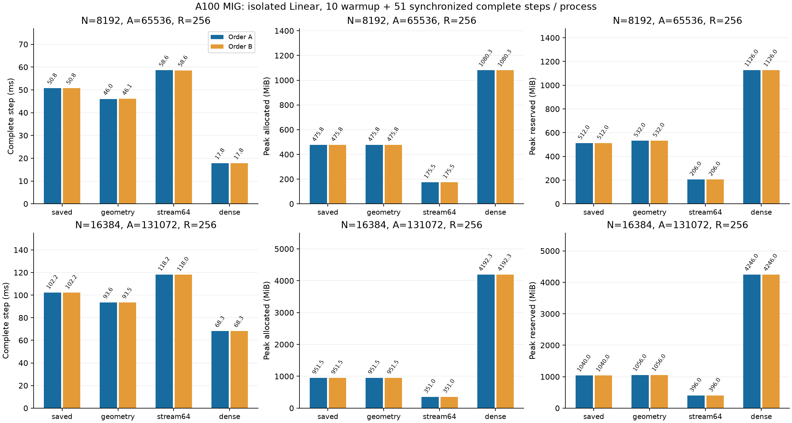

# Reusing per-Atom geometry across token rows

**English** | [日本語](multirow-geometry-20261108.ja.md)

The controlled N16384 row comparison's first order identifies forward/backward,
not the optimizer, as the large-R cost. At R256 the separate diagnostic medians
are41.59/59.91/1.42ms for forward+loss/backward/optimizer (they must not be summed
or subtracted to construct a primary time). Code inspection shows projection
and expansion decode the same radius, wrapped center and9 Fourier coefficients
for each8-row group, and again for backward.

Candidate `cuda_radius_large_multirow_geometry` computes the existing FP32
25-value geometry per Atom once per forward, then reuses it for projection,
expansion and gradient groups through backward. It is retained by that autograd
invocation, with the original input/Parameters and their normal version checks.
There is no cache on the Algorithm, no CPU atom read, no math/Polar/LR change,
and no dense W/dW. The extra forward retention is100A bytes (6.25/12.5MiB at
N8192/16384). Baseline already creates the same transient table in backward;
measure the peak rather than assuming this retention is free.

Keep the original saved and recompute routes selectable. Defaults, Tensor
transform fallback, first-order differentiation restrictions and old scopes
remain unchanged. New templates default to the original uncached route.
Check varying radius/periodic images, R1/9/256 tails, high owner keys, noncontiguous
input, both single-gradient branches, saved hooks, retained backward and stale
Parameter rejection. Qualify fullN2048/A8N Y/dX/dP and optimizer using existing
CPU FP64/independent quadrature and matched-state gates before performance.

Use R256/N8192/16384/A8N and exactly the frozen width-study initialization and
data. Existing worker loops:10 warmup+51 timed complete synchronized steps;
allocator peaks include all61. Fresh processes, two reversed width/arm orders:
A8192→16384, saved→geometry→stream64→Dense; B16384→8192, Dense→stream64→geometry→saved. Keep all
operator/gradient/Adam/Parameter tolerances and initial/updated full VJP checks.
Preserve failures; stop on any gate/OOM/nonfinite/timeout. Fresh source/build,
no concurrent GPU experiments. Compare same-kind final hashes across orders;
geometry-vs-saved byte equality is recorded, not assumed, since precomputing
can change compiler rounding. Public/default adoption remains a separate step.

The hypothesis and protocol above were fixed before measurement; results follow below.

## Windowed recomputation candidate (fixed before GPU measurement)

`cuda_radius_large_multirow_stream64` retains only x/P, owner keys and the same
geometry table. Forward emits64-row windows into Y; backward regenerates moments
and responses in64-row windows. It retains all ceil(R/8)×A×3 FP32 gradient partials
until one final reduction in exactly the original eight-row-group order. Thus
it does not sum independently reduced per-window dP (which would change order).
The unchanged two orientation passes and forward projection recomputation run
inside the synchronized complete-step clock; Y/dX window copies also count.
At R256 the Z/H/G scratch scales with64 rather than256 rows. Full x/Y/dX and the
partial table remain. No change to Atom count, Parameters, update state or batch
loss scaling. Check R65 as well as R1/9/256, and both gradient branches/retained
backward/version checks for both new candidates. Qualify N2048 for both before
all16 large observations. Record saved-vs-geometry-vs-stream final hash equality
without assuming it. This is not a public checkpointing API or an adopted default.

For stream64 at R256/N16384/A131072, those two Z/H/G pairs use about199.983MiB
in total, while the full partial table48MiB and geometry12.5MiB remain. The
shape-derived core working set is260.483MiB instead of860.434MiB. Input/output,
optimizer and owner metadata are additional; actual allocator peaks determine
the realized saving. A full-R loss/dY is preserved, so windowing does not change
batch-loss normalization or optimizer update frequency.

## Audited results

Numeric commit `4f4a446124bd68fc2683ccac16e3131ae54aed9f`; 171 CPU/CUDA regression tests
passed. N2048 qualifications and every initial/updated large-width full VJP
check passed under the existing tolerances. Both reversed orders are retained.

| N | Arm | Step ms A / B | Allocated MiB A / B | Reserved MiB A / B |
| ---: | --- | ---: | ---: | ---: |
| 8192 | saved | 50.753 / 50.754 | 475.761 / 475.761 | 512 / 512 |
| 8192 | geometry | 46.040 / 46.065 | 475.761 / 475.761 | 532 / 532 |
| 8192 | stream64 | 58.596 / 58.566 | 175.511 / 175.511 | 206 / 206 |
| 8192 | dense | 17.845 / 17.849 | 1080.251 / 1080.251 | 1126 / 1126 |
| 16384 | saved | 102.152 / 102.174 | 951.511 / 951.511 | 1040 / 1040 |
| 16384 | geometry | 93.566 / 93.504 | 951.511 / 951.511 | 1056 / 1056 |
| 16384 | stream64 | 118.156 / 118.019 | 351.011 / 351.011 | 396 / 396 |
| 16384 | dense | 68.270 / 68.280 | 4192.251 / 4192.251 | 4246 / 4246 |

[Machine-readable results](multirow-geometry-20261108-results.json) retain original-result hashes
and final-state equality checks. Canonical local evidence: `output/large-geometry-20261108-01`.
Archive SHA256 `4ff5c8d53caeebacb5e3e7a46dee7e9c341536f27bd4ddc11fc0cd3b72a24b57`; 52 compact originals verified,
all owned controller/worker PIDs ended, frozen source/binary/input hashes checked.
Actual initial tensors were independently restored in the width study. Final
Parameter/gradient/Adam/clock hashes only; no final-state or raw oracle payload archive.
No public default or dispatcher adoption.

Geometry reuse reduces complete-step time8.4–9.3% versus the same-source saved
baseline. Allocated peak stays unchanged; reserved rises slightly. Stream64
reduces allocated peak63.1% at both widths, at a15.4–15.7% time cost versus saved.
At N16384 its351.011MiB is8.37% of Dense's4192.251MiB. Dense is still faster.
All five final-state tensors (Parameters, gradients, Adam moments, step counter)
are byte-identical between saved/geometry/stream64 and across both orders for
this61-update cohort. This is not a universal bitwise-equivalence/quality claim.

A subsequent checkpoint adds metadata validation for unpacked geometry tensors
before native backward reads, with a malformed-hook regression. It changes no
valid arithmetic; final-source GPU requalification is recorded with the
[hierarchy-level launch study](multirow-levels-20261108.md).
