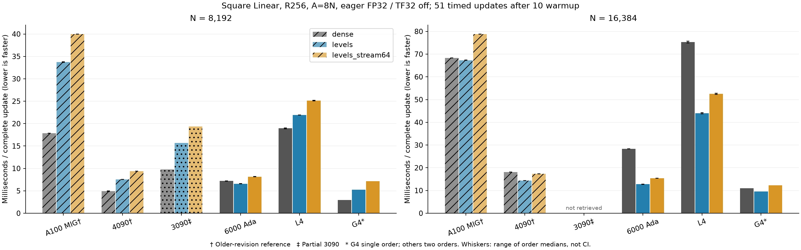

# Multirow LinearのGPU比較、2026-11-08

[English](multirow-hardware-20261108.md) | **日本語**

LM研究に戻る前に、実行GPUを選ぶための測定を依頼された。
現revisionで測ったCST levelsの絶対速度はG4が最速で、今回測った九工大環境では
確保できたRTX 6000 Adaが有力だった。N16384のlevelsは12.71–12.79ms、Denseは
28.34–28.36ms。G4の短期1順序ではlevels 9.56 ms、Dense 10.98 msだった。

## 完全な1更新の時間

単位はms/更新。正方形d_in=d_out=N、R256、A8N、FP32、TF32off、Xavier normal/q0、
seed41、fused AdamWのlr1e-4/decay0で揃えた。各workerは10warmup＋51計測更新を
行う。入力と教師値はGPU常駐。同期したタイマーはzero_grad・dXリセット・
forward/MSE・backward（dXと全Parameter）・AdamWを含み、転送・コンパイル・
初期化・CPU/GPUでの正しさ検査を除く。CUDA Graphや混合精度の結果ではない。

| GPU | N8192 Dense | levels | stream64 | N16384 Dense | levels | stream64 |
| --- | ---: | ---: | ---: | ---: | ---: | ---: |
| A100 MIG 3g.40gb † | 17.85–17.85 | 33.68–33.79 | 39.97–39.99 | 68.27–68.30 | 67.29–67.37 | 78.73–78.83 |
| RTX 4090 † | 4.86–5.01 | 7.55–7.56 | 9.39–9.41 | 18.13–18.14 | 14.33–14.40 | 17.34–17.36 |
| RTX 3090 ‡ | 9.78 | 15.69 | 19.35 | - | - | - |
| RTX 6000 Ada | 7.17–7.20 | 6.56–6.61 | 8.11–8.17 | 28.34–28.36 | 12.71–12.79 | 15.36–15.40 |
| L4 | 18.86–19.03 | 21.95–21.95 | 25.06–25.20 | 74.93–75.74 | 43.78–44.24 | 52.28–52.83 |
| G4 Blackwell * | 2.95 | 5.27 | 7.14 | 10.98 | 9.56 | 12.31 |

† 検証済みの旧095684 revision参考値。‡3090はprofile切替前にN8192の初回だけ
回収した。新サーバーから元保存先は見えておらず、他条件の完了は未確認。
* G4はColab使用を抑えるため1順序。他の完全なコホートは逆順2回。
範囲は各順序の中央値の範囲であり、信頼区間や独立VMでの反復ではない。

## メモリと数値検証

optimizer状態の確保を含むPyTorch allocatedの学習時ピーク。
GPUプロセス全体のメモリではない。reservedの値もJSON証拠に保持した。

| GPU, N16384 | Dense allocated MiB | levels | stream64 |
| --- | ---: | ---: | ---: |
| RTX 6000 Ada | 4192.3–4192.3 | 951.5–951.5 | 351.0–351.0 |
| L4 | 4192.3–4192.3 | 951.5–951.5 | 351.0–351.0 |
| G4 Blackwell | 4240.0 | 951.5 | 351.0 |

RTX 6000 AdaとL4は回帰223件、N2048の独立資格検査2条件、実測全条件の初期・
更新後Y/dX/全Atom VJPに合格した。逆順間とlevels/stream64間でParameter・勾配・
AdamW moment・61更新counterのhashが一致した。G4はN2048の2検査、実測6条件の
VJPとschedule間状態監査に合格。G4では回帰223件と逆順を繰り返していない。

L4の元producerは、最後の監査が `qualification-2048-levels_stream64.json` を
探した一方、producer側が `qualification-2048-levels-stream64.json` と保存したため
終了コード1になった。その前の12workerは全て合格済み。元の失敗を保存し、
回収済みの不変ファイルに対してファイル名だけを修正し、監査出力を別のローカル
保存先へ移して同じ検査に合格した。数値条件・許容誤差を変更せず、この修正の
ためのGPU再実行はしていない。

## 証拠と限界

[集約JSON](multirow-hardware-20261108.json)にソース・環境・各結果とarchiveのhashを
記録した。新測定のソースは `b393ac653f3b3893c378acda1c1752919c1539d1`、
旧A100 MIG3g.40gbと4090は `095684f01f8527e190459529d05978abfd3f95be`。
A100は80GB PCIe機の分割環境で、フルA100の値ではない。Torch/CUDA/CPUが異なり、
環境をまたぐ初期Pのbyte一致は主張しない。各環境内では初期値・入力を固定し、
全方式・順序で同一のものを使った。GPU単体の効果を分離した比較ではない。

| GPU | Actual device | Torch | CUDA |
| --- | --- | --- | --- |
| A100 MIG 3g.40gb | NVIDIA A100 80GB PCIe MIG 3g.40gb | 2.6.0+cu126 | 12.6 |
| RTX 4090 | NVIDIA GeForce RTX 4090 | 2.6.0+cu126 | 12.6 |
| RTX 3090 | NVIDIA GeForce RTX 3090 | 2.6.0+cu126 | 12.6 |
| L4 | NVIDIA L4 | 2.14.1+cu130 | 13.0 |
| RTX 6000 Ada | NVIDIA RTX 6000 Ada Generation | 2.9.1+cu128 | 12.8 |
| G4 Blackwell | NVIDIA RTX PRO 6000 Blackwell Server Edition | 2.14.1+cu130 | 13.0 |

原本はignoredの `output/large-levels-l4-20261108-02`、
`output/large-levels-6000ada-20261108-01`、
`output/large-levels-g4-20261108-01`、3090途中結果、旧測定2保存先にある。
L4/G4はpoolの全archiveと入力PTを回収してhashを照合済み。
RTX 6000 Adaは54ファイルのコンパクトな証拠を回収・検証し、入力・ソース・native buildは
名前を付けたcluster保存先に保持した。最終benchmark状態はTensor本体ではなく
hashを保持する。所有Colab VMは全て停止、RTX 6000 Adaの所有20プロセスも非稼働。
新たなLM学習は投入していない。モデル精度・目標精度までの時間・最小Atom数・
形式的な漸近オーダー・公開default採用を示す試験ではない。
