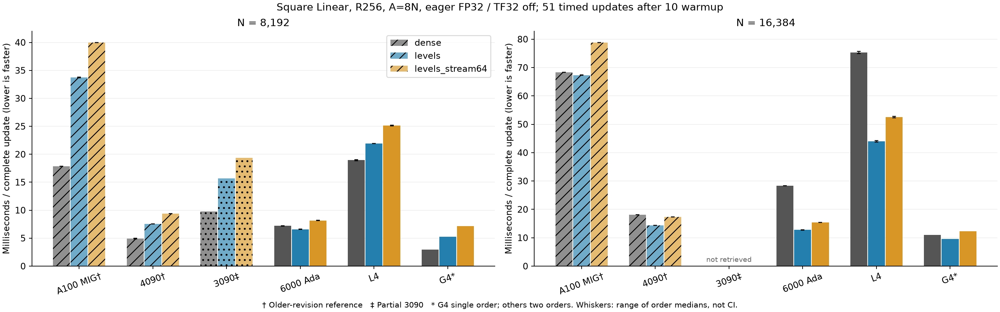

# Multirow Linear hardware comparison, 2026-11-08

**English** | [日本語](multirow-hardware-20261108.ja.md)

The owner requested hardware selection before returning to the LM study.
Among the current-revision observations, G4 was fastest in absolute CST levels
time; the secured RTX 6000 Ada was the strongest Kyutech option measured here.
Its N16384 levels observations were 12.71–12.79 ms, versus 28.34–28.36 ms for Dense.
G4 measured 9.56 ms levels and 10.98 ms Dense in its one short order.

## Complete-update time

All numbers are milliseconds per update. Square `d_in = d_out = N`, 256 input rows, `A = 8N`, FP32,
TF32 off, Xavier normal/q0, seed 41, fused AdamW lr=1e-4/decay=0. Every worker performs
10 warmup + 51 timed updates. Inputs/targets are already on GPU. The synchronized
timer includes zero_grad, dX reset, forward/MSE, backward (dX and all Parameters),
and AdamW. Transfer, compilation, initialization and CPU/GPU correctness work are
outside the timer. No CUDA Graph or mixed-precision claim.

| GPU | N8192 Dense | levels | stream64 | N16384 Dense | levels | stream64 |
| --- | ---: | ---: | ---: | ---: | ---: | ---: |
| A100 MIG 3g.40gb † | 17.85–17.85 | 33.68–33.79 | 39.97–39.99 | 68.27–68.30 | 67.29–67.37 | 78.73–78.83 |
| RTX 4090 † | 4.86–5.01 | 7.55–7.56 | 9.39–9.41 | 18.13–18.14 | 14.33–14.40 | 17.34–17.36 |
| RTX 3090 ‡ | 9.78 | 15.69 | 19.35 | - | - | - |
| RTX 6000 Ada | 7.17–7.20 | 6.56–6.61 | 8.11–8.17 | 28.34–28.36 | 12.71–12.79 | 15.36–15.40 |
| L4 | 18.86–19.03 | 21.95–21.95 | 25.06–25.20 | 74.93–75.74 | 43.78–44.24 | 52.28–52.83 |
| G4 Blackwell * | 2.95 | 5.27 | 7.14 | 10.98 | 9.56 | 12.31 |

† Historical verified 095684 revision. ‡ Only the 3090 N8192 first order was
retrieved before the server profile changed; the original directory was not
visible on the new server. * G4 has one fixed order to bound Colab use; the
other complete cohorts have two reversed orders. Ranges are ranges of order
medians, not confidence intervals or independent VM replicates.

## Memory and numerical admission

These are PyTorch allocated training peaks, including optimizer-state allocation,
not total process GPU memory. Reserved peaks are retained in the JSON evidence.

| GPU, N16384 | Dense allocated MiB | levels | stream64 |
| --- | ---: | ---: | ---: |
| RTX 6000 Ada | 4192.3–4192.3 | 951.5–951.5 | 351.0–351.0 |
| L4 | 4192.3–4192.3 | 951.5–951.5 | 351.0–351.0 |
| G4 Blackwell | 4240.0 | 951.5 | 351.0 |

RTX 6000 Ada and L4 passed 223 regressions, two N2048 independent qualifications,
and every measured-case initial/updated Y/dX/all-Atom VJP. Their repeat-order
and levels/stream64 Parameter, gradient, AdamW-moment and 61-step-counter hashes
matched exactly. G4 passed its two N2048 gates, all six actual-case VJPs and
cross-schedule state audit; full 223 and reverse order were not repeated there.

L4's original producer returned 1 because the final auditor looked for
`qualification-2048-levels_stream64.json`, while the producer named it
`qualification-2048-levels-stream64.json`. All 12 worker runs had already passed.
The original failure is preserved. A filename-only correction and relocated
local output passed the same audit against the immutable retrieved files;
no numerical gate or tolerance changed and no GPU rerun was used for that fix.

## Evidence and limits

[Aggregate JSON](multirow-hardware-20261108.json) records sources, runtimes,
individual result hashes and archive hashes. New source is
`b393ac653f3b3893c378acda1c1752919c1539d1`; historical A100 MIG 3g.40gb and 4090
source is `095684f01f8527e190459529d05978abfd3f95be`. A100 is a partitioned
80GB PCIe device, not a full-A100 observation. Torch/CUDA/CPU environments differ;
initial P byte identity across runtimes is not claimed. Each runtime froze its
own inputs/Parameters and reused them identically across its methods/orders.
This compares the observed environments, not GPU hardware in isolation.

| GPU | Actual device | Torch | CUDA |
| --- | --- | --- | --- |
| A100 MIG 3g.40gb | NVIDIA A100 80GB PCIe MIG 3g.40gb | 2.6.0+cu126 | 12.6 |
| RTX 4090 | NVIDIA GeForce RTX 4090 | 2.6.0+cu126 | 12.6 |
| RTX 3090 | NVIDIA GeForce RTX 3090 | 2.6.0+cu126 | 12.6 |
| L4 | NVIDIA L4 | 2.14.1+cu130 | 13.0 |
| RTX 6000 Ada | NVIDIA RTX 6000 Ada Generation | 2.9.1+cu128 | 12.8 |
| G4 Blackwell | NVIDIA RTX PRO 6000 Blackwell Server Edition | 2.14.1+cu130 | 13.0 |

Raw evidence is in ignored `output/large-levels-l4-20261108-02`,
`output/large-levels-6000ada-20261108-01`,
`output/large-levels-g4-20261108-01`, the 3090 partial directory, and the two
historical evidence directories. L4/G4 complete pool archives and input PT
payloads were downloaded and hash-verified. RTX 6000 Ada compact evidence has 54
verified files; its inputs/source/native builds remain in its named cluster job
directory. Final benchmark states are retained as hashes, not tensor payloads.
All owned Colab VMs are stopped; 20 owned RTX 6000 Ada job processes are inactive.
No new LM learner was launched. No model-quality, time-to-target, minimum-Atom,
formal asymptotic or public-default adoption conclusion follows from this pilot.
