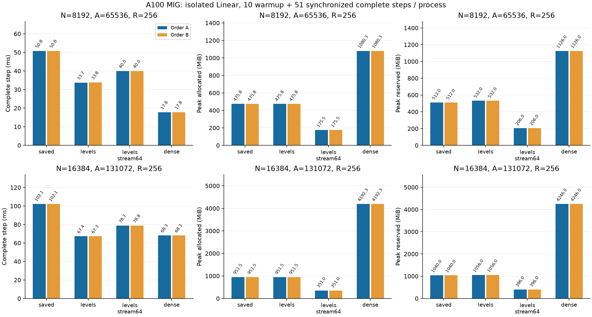

# 処理するmoment階層だけを起動する

[English](multirow-levels-20261108.md) | **日本語**

コード上、packed_momentsは各階層にR×(N-2)×17スレッドを起動するが、その階層の
2 bank以外は書かない。非活性階層も全gridを起動してからdevice maskでreturnする。
N8192/16384ではlevel2〜log2(N)の12/13回起動がある。これはスケジュールの費用で、
Fourier/セル質量の演算自体の変更ではない。

既存の呼出し内geometry再利用と階層を絞ったgridを組み合わせる研究Algorithmを別に用意する。
`cuda_radius_large_multirow_levels`は応答保存、
`cuda_radius_large_multirow_levels_stream64`は64行単位の再計算である。
階層lではR×2(N/2^l)×17スレッドを起動し、従来のcompact Z位置へ写像して同じ
compact_moment_elementを呼ぶ。device上のrequired bank mask、子bankの包含、階層昇順の
依存関係、加算順、moment保存layoutを維持。全階層の名目スレッド合計はR×(N-2)×17となり、
従来の12/13倍の起動を減らす。時間がこの比率で速くなるとは仮定しない。旧Algorithmのgrid・
既定値と、保存/64行単位再計算の保持方式は維持する。

計測前にsource・protocol・入力hashを固定する。A100 MIG3g.40gb限定、FP32 IEEE/TF32無効、
N2048で検証後、N8192/16384・R256・A8N・Xavier/q0/minimum-001を使う。初期P/x/target/dYは
幅比較の凍結値。対象CUDA回帰全体と、両候補のN2048全VJP・独立求積・matched updateを確認。
基準は変えず、失敗・OOM・非有限・timeoutで証拠を残して止める。GPU実験は同時実行しない。

fresh processで、Aは幅8192→16384・保存→levels→levels_stream64→Dense、
Bは幅16384→8192・Dense→levels_stream64→levels→保存。既存workerのwarmup10＋同期した
完全stepの計時51、全61更新がallocated/reserved peak対象。初期・更新後全VJP、Denseとの初期
演算子一致、optimizer、状態hash、source/extension hash、全sampleを維持。両順序・完全step時間・
メモリを記録し、精度・独立hardware再現・Graph・公開採用を推論しない。従来geometry/窓単位再計算と
比較する場合はsourceの異なる別実験として扱う。

これは計測前に固定したprotocolである。比較は完了し、追加の推測的最適化を止め、実測した選択肢を
reviewできる状態に保全した。

## 研究用の明示選択

対応する大規模正方の`layer`に、既存selector APIで保存版か64行単位再計算を選ぶ。
限定cohort用のprivate opt-inで、公開CSTLinearの新しいflagではない。
厳密なPlan recipeは保存版で`save_response=True`、stream64で`False`とし、
別Algorithmが実行・保持方式を識別する。optimizerやbatch lossは変えない。

```python
from torchcst import FixedSelector, make_algorithm_registry
from torchcst._backends.cuda.algorithms.linear.radius_cell_mass.large_multirow import (
    LARGE_LEVELS,
    LARGE_LEVELS_STREAM64,
    RadiusLargeLevelsAlgorithm,
    RadiusLargeLevelsStream64Algorithm,
)

registry = make_algorithm_registry()
registry.register(RadiusLargeLevelsAlgorithm())
registry.register(RadiusLargeLevelsStream64Algorithm())
layer.selector = FixedSelector(LARGE_LEVELS_STREAM64, registry=registry)
# Saved responses instead:
# layer.selector = FixedSelector(LARGE_LEVELS, registry=registry)
```

許可範囲：FP32正方N2048/8192/16384、R1〜256、A4〜8N、origin0/spacing1、
Polar M8/base1/merge2、radius[.5,50]。実測はA8N。他の範囲・Graph・dtypeは未検証/拒否。
selectorは学習状態ではないためcheckpoint復元後に再指定する。厳密な再現には記録した
コミットのsource・catalog・凍結Caseを使う。

## 監査済み結果

数値計算コミット`095684f01f8527e190459529d05978abfd3f95be`。CPU/CUDA回帰187件に合格。
N2048の検証と大規模各観測の初期・更新後全VJPも既存基準で合格した。両順序を保全する。

| N | Arm | Step ms A / B | Allocated MiB A / B | Reserved MiB A / B |
| ---: | --- | ---: | ---: | ---: |
| 8192 | saved | 50.782 / 50.767 | 475.761 / 475.761 | 512 / 512 |
| 8192 | levels | 33.675 / 33.791 | 475.761 / 475.761 | 532 / 532 |
| 8192 | levels_stream64 | 39.971 / 39.987 | 175.511 / 175.511 | 206 / 206 |
| 8192 | dense | 17.846 / 17.846 | 1080.251 / 1080.251 | 1126 / 1126 |
| 16384 | saved | 102.144 / 102.136 | 951.511 / 951.511 | 1040 / 1040 |
| 16384 | levels | 67.369 / 67.292 | 951.511 / 951.511 | 1056 / 1056 |
| 16384 | levels_stream64 | 78.733 / 78.829 | 351.011 / 351.011 | 396 / 396 |
| 16384 | dense | 68.274 / 68.299 | 4192.251 / 4192.251 | 4246 / 4246 |




[機械可読集計](multirow-levels-20261108-results.json)に元結果のhashと最終状態の一致判定を記録した。
canonical証拠：`output/large-levels-20261108-02`。archive SHA256：
`8d80e920729153fcd71fa8ce71e6ec01c3d25ec791729785fa411f1b900ef357`。52原本を照合し、所有controller/worker
PIDの終了、凍結source・binary・入力hashを確認。実初期Tensorは幅比較で独立復元済み。
最終状態はParameter/勾配/Adam/clockのhashのみで、最終状態payloadや生oracle Tensorは
archiveしていない。公開既定値・dispatcherへの採用は含まない。

geometry再利用と階層別gridを組み合わせた経路は、同sourceのFP32保存版より完全step時間を
33.4〜34.1%短縮した。N16384では67.292〜67.369msで、Denseの68.274〜68.299msと同程度。
allocatedは951.511MiB対4192.251MiB。小さな時間差から一般的な優越や独立hardware再現は
主張しない。N8192では33.675〜33.791msで、Denseの17.846msよりまだ遅い。

階層別gridのstream64は、両幅とも従来保存版より速く、allocated peakも63.1%減らした。
N16384では78.733〜78.829ms（Denseより15.3〜15.4%時間増）、351.011MiB
（Dense allocatedの8.37%）。reservedは396MiB対Dense4246MiB。速度優先の保存版より
約17%時間を増やしてピークを大幅に減らす、このcohortで選べる交換条件である。

61更新後の最終5 Tensor（Parameter・勾配・Adam moment・clock）は、両幅・両順序とも
保存/levels/levels_stream64間でbyte完全一致した。候補追加で数値基準は緩めていない。
全観測の初期・更新後VJPと両N2048 matched-update検証も合格。対象CPU/CUDA回帰187件は、
native読出し前の復元geometry形状検査、有効なsaved hook、version検査、片側勾配を含む。

最初のlevels snapshot（`large-levels-20261108-01`、94ce6ff5）は待機中に置き換えた。
controller/GPU実行前にmetadata guardと4回帰を加えるためで、元source・payload・待機停止
記録は保全してある。実測した試行02は095684f0で、数値kernelの演算は同じ。
そのGPU専用hook4件を加える前のローカル全CPU suiteは2193passed/2571skipped。
wheel/sdistビルドとCUDA source/header38ファイルのpayload照合も合格。
最終report HEADのGitHub CIはPR154で別記する。

大規模幅の本タスクで把握したcontroller/workerの92 PID（計測前に失敗したbatch試行を含む）を
終了確認した。置換した待機launcherも終了済み。A100サーバーや無関係なjobには触れていない。
追加の推測的最適化は動かしていない。正方Linearの計測は、大きな長方形FFNやLM全体の速度・精度を
示すものではなく、公開selector/既定値への採用も行わない。上の研究用明示選択を使う。
