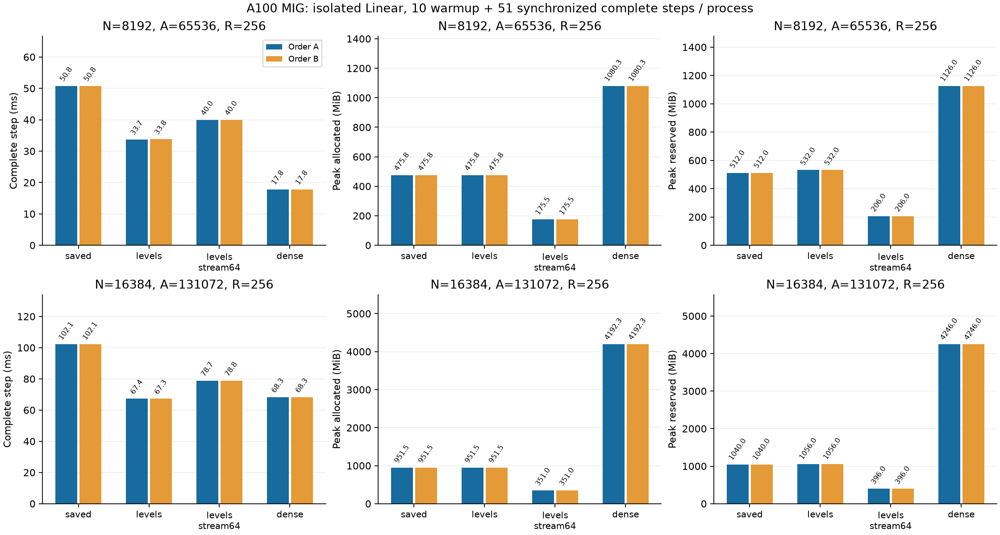

# Launching only the current moment level

**English** | [日本語](multirow-levels-20261108.ja.md)

Code inspection found that packed_moments launches R×(N-2)×17 threads for each
level, although each level writes only its own two banks. Inactive levels also
receive the full grid before returning on the device mask. For N8192/16384,
levels2..log2(N) require12/13 such launches. This is scheduling overhead, not a
change to the Fourier/cell-mass operation.

Two separate research Algorithms combine the previous per-invocation geometry
reuse with a restricted moment grid: `cuda_radius_large_multirow_levels` saves
responses; `cuda_radius_large_multirow_levels_stream64` uses64-row recomputation.
At level l, launch R×2(N/2^l)×17 threads, map each to the original compact Z slot,
and call the unchanged compact_moment_element. Preserve the device-side required
bank mask, child-bank closure, ascending level dependency, summation order and
full moment storage layout. Total nominal threads across levels become
R×(N-2)×17 instead of12/13 times that value. The speedup is not assumed to equal
the thread-count ratio. Old Algorithms retain their original grid and defaults.
The retained-storage/64-row policies are unchanged.

Before measurement, freeze source, protocol and input hashes. Use only A100 MIG
3g.40gb, FP32 IEEE/TF32 off, N2048 qualification then N8192/16384,R256,A8N,
Xavier/q0/minimum-001 and frozen P/x/target/dY from the width study. Run the
complete targeted CUDA regressions and N2048 full VJP/independent quadrature/
matched-update gates for both candidates. Maintain all tolerances; preserve and
stop on failure/OOM/nonfinite/timeout. No simultaneous GPU experiment.

Fresh processes, A widths8192→16384 and saved→levels→levels_stream64→Dense;
B widths16384→8192 and Dense→levels_stream64→levels→saved. Each observation uses
the existing worker's10 warmup+51 synchronized complete timed steps; all61 enter
allocated/reserved peaks. Full initial/updated VJPs, same initial operator for
Dense, unchanged optimizer, state hashes, source/extension hashes and all samples
remain mandatory. Record both orders, complete-step time and memory; do not
infer quality, hardware replication, Graph support or public adoption. Compare
with previous geometry/windowing observations as separate source studies.

The protocol was fixed before measurement. The comparison is complete; further
speculative optimization is stopped and the measured options are preserved.

## Explicit research selection

For an already compatible large-square `layer`, select the saved or64-row
recomputation Plan using the existing selector API. This is a private cohort
opt-in, not a new public CSTLinear flag. The strict Plan recipe declares
`save_response=True` for saved and `False` for stream64; the distinct Algorithm
identifies its execution/retention policy. No optimizer or batch-loss change.

```python
from torchcst import FixedSelector, make_algorithm_registry
from torchcst._backends.cuda.algorithms.linear.radius_cell_mass.large_multirow import (
    LARGE_LEVELS,
    LARGE_LEVELS_STREAM64,
    RadiusLargeLevelsAlgorithm,
    RadiusLargeLevelsStream64Algorithm,
)

registry = make_algorithm_registry()
registry.register(RadiusLargeLevelsAlgorithm())
registry.register(RadiusLargeLevelsStream64Algorithm())
layer.selector = FixedSelector(LARGE_LEVELS_STREAM64, registry=registry)
# Saved responses instead:
# layer.selector = FixedSelector(LARGE_LEVELS, registry=registry)
```

Admitted scope: FP32 square N2048/8192/16384, R1..256, A4..8N, origin0/spacing1,
Polar M8/base1/merge2 and radii[.5,50]. Measurements use A8N. Other scopes,
Graphs and dtypes are unqualified/rejected. Reapply the selector after restoring
a checkpoint; it is not model training state. Source, catalog and frozen Case
must match the recorded commit for exact reproduction.

## Audited results

Numeric commit `095684f01f8527e190459529d05978abfd3f95be`; 187 CPU/CUDA regression tests
passed. N2048 qualifications and every initial/updated large-width full VJP
check passed under the existing tolerances. Both reversed orders are retained.

| N | Arm | Step ms A / B | Allocated MiB A / B | Reserved MiB A / B |
| ---: | --- | ---: | ---: | ---: |
| 8192 | saved | 50.782 / 50.767 | 475.761 / 475.761 | 512 / 512 |
| 8192 | levels | 33.675 / 33.791 | 475.761 / 475.761 | 532 / 532 |
| 8192 | levels_stream64 | 39.971 / 39.987 | 175.511 / 175.511 | 206 / 206 |
| 8192 | dense | 17.846 / 17.846 | 1080.251 / 1080.251 | 1126 / 1126 |
| 16384 | saved | 102.144 / 102.136 | 951.511 / 951.511 | 1040 / 1040 |
| 16384 | levels | 67.369 / 67.292 | 951.511 / 951.511 | 1056 / 1056 |
| 16384 | levels_stream64 | 78.733 / 78.829 | 351.011 / 351.011 | 396 / 396 |
| 16384 | dense | 68.274 / 68.299 | 4192.251 / 4192.251 | 4246 / 4246 |




[Machine-readable results](multirow-levels-20261108-results.json) retain original-result hashes
and final-state equality checks. Canonical local evidence: `output/large-levels-20261108-02`.
Archive SHA256 `8d80e920729153fcd71fa8ce71e6ec01c3d25ec791729785fa411f1b900ef357`; 52 compact originals verified,
all owned controller/worker PIDs ended, frozen source/binary/input hashes checked.
Actual initial tensors were independently restored in the width study. Final
Parameter/gradient/Adam/clock hashes only; no final-state or raw oracle payload archive.
No public default or dispatcher adoption.

The combined geometry-reuse/level-grid route cuts complete-step time33.4–34.1%
versus the same-source FP32 saved baseline. At N16384,67.292–67.369ms is near
Dense's68.274–68.299ms, with951.511MiB allocated versus4192.251MiB. The tiny time
advantage is not a general superiority claim or hardware replication.
At N8192,33.675–33.791ms still exceeds Dense's17.846ms.

Level-grid stream64 is faster than the original saved baseline at both widths
while reducing allocated peak63.1%. At N16384 it takes78.733–78.829ms (15.3–15.4%
more time than Dense) and351.011MiB (8.37% of Dense allocated). Reserved is396MiB
versus Dense4246MiB. It trades about17% more time than the fast saved route for
much lower peak storage. This is a useful selectable tradeoff in this cohort.

All five final-state tensors—Parameters, gradients, Adam moments and clock—are
byte-identical between saved/levels/levels_stream64 and across both orders at
both widths after61 updates. No numerical tolerance was relaxed for these
candidates. Full initial/updated VJPs and both N2048 matched-update qualifications
passed.187 targeted CPU/CUDA tests include restored-geometry shape validation
before native reads, valid saved hooks, version checking and gradient branches.

The first levels snapshot (`large-levels-20261108-01`,94ce6ff5) was superseded
while queued, before its controller or GPU work started, to add that metadata
guard and four regression cases. Its source/payload/queue-stop record remain;
measured attempt02 uses095684f0 with the same numeric kernel operation.
Local full CPU suite before those four GPU-only hook cases:2193passed/2571skipped.
Wheel/sdist builds passed; all38 CUDA source/header payloads were verified.
Final-report-HEAD GitHub CI is reported on PR154 separately.

The92 known controller/worker PIDs across this large-width task, including the
failed batch premeasurement attempt, were checked inactive. The superseded queue
launcher is inactive too; the A100 server and unrelated jobs were left untouched.
No further speculative optimization is running. Square-Linear measurements do
not establish large rectangular FFN or whole-LM speed/quality, and no public
selector/default adoption is made. Use the explicit research selection above.
