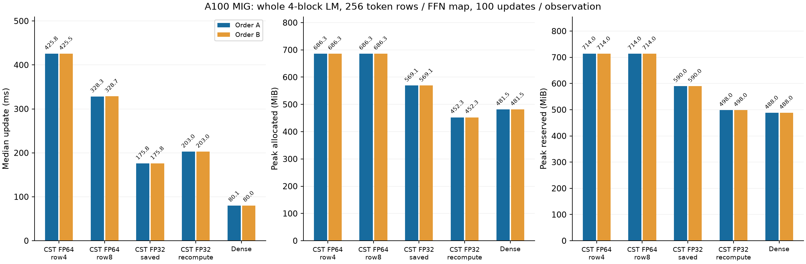
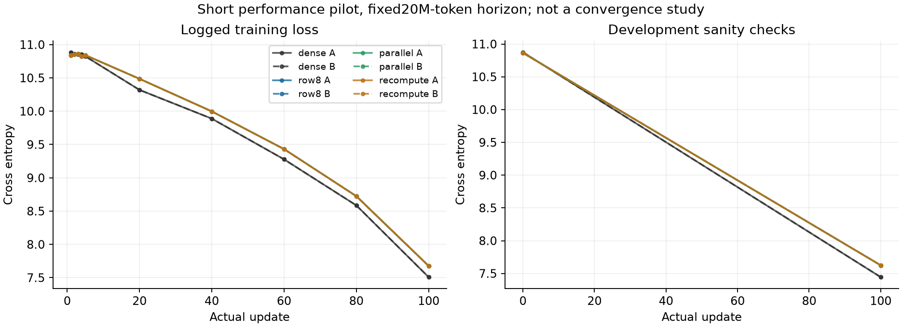

# 多入力中間値のFP32化とAtom勾配の行並列化

[English](multirow-packed-20261107.md) | **日本語**

先のrow8 pilotでは更新時間を22.7%短縮したが、Z/H/GはFP64保存のままだった。
今回は演算の数学・初期化・支持・正規化・radiusをdetachするtask VJP・native Polar更新を
維持する。production defaultや他GPUは変更しない。

ユーザーの補足に従い、Linearのradius/center decode・routing判定・係数・位相・縮約・
moment/response保存をFP32とする。FP64は比較参照であり、新Linearの要件ではない。
共通host設定scalarや変更しないoptimizerは、このLinearの信号計算とは別である。

| Algorithm末尾 | 逆伝播まで保存するもの | Atom勾配の実行 |
| --- | --- | --- |
| packed | FP32 Z/H | 従来の行順次縮約 |
| packed_recompute | X/P/keyのみ。FP32 Z/Hを再計算 | 8行groupとFP32部分縮約 |
| packed_parallel | FP32 Z/H | 8行groupとFP32部分縮約 |

既存8行展開に加え、response projectionも8行共有とする。
parallel版はAtom幾何を小さい一時FP32 tableへ一度計算して、行groupをCTAへ分散する。
R256/A4096でFP32のgeometry/partial scratchは0.390625/1.5 MiB。保存activationではなく一時領域である。
dense Wの構築、Atomの省略、tile別の再正規化はしない。
再計算はforward時のSavedVariablesを使い、version検査・saved Tensor hook・一階微分制限を維持する。

対象は256↔1024 FFN、A4096、FP32、R1〜256、Polar modes8/base1/merge2/spacing1、
radius[.5,50]。4行・FP64 row8の対照は別に選べるままとする。
Tensor/function変換は旧経路へ明示fallbackし、その場合の性能・メモリは主張しない。
Graphは拒否する。

計時前にmetadata・直列化・保存方針、GPU境界・端数、既存global-native回帰を確認する。
dXのみ・Atomのみの逆伝播、逆伝播再実行・変更検知を調べる。
保存するbulk配列がFP32で、再計算版はZ/Hを保存しないことを確認する。
各候補のFFN両方向R256/A4096の全VJPをCPU FP64 Fourier/autograd参照と照合し、
既存atol3e-5/rtol3e-4と独立polynomial求積を維持する。
実4block taskの再開とrow8対照の3更新で勾配・Parameter・Adam moment/clockを比較し、
完全一致は別に報告する。演算VJPとtask勾配はatol=3e-5/rtol=3e-4、
Adam momentはatol=3e-7/rtol=3e-5を維持する。最初のParameter基準
（atol=3e-6/rtol=3e-5）と、その後のatol=1e-5では、Adam更新後の小さな差を不合格とした。
両方の失敗を保全する。ユーザーがFP32の差を明示的に許容した後、Parameterも
FP32演算と同じatol=3e-5/rtol=3e-4で比較し、性能計測前に固定した。
これは合格方針の明示的な改訂であり、元の基準に合格したという意味ではない。
独立した演算検証、全勾配、optimizer moment/clockの基準は緩めていない。

既存cst-research FFN learnerと同じTinyStories token/data順序を使う。
A10080GBPCIe MIG3g.40gbのみ、TF32off、幅256/4block/4head/FFN4N、
batch2×context128（R256）、accumulation4、seed17、c8/A4096、q0、minimum-001、
AtomLR16倍、baseLR3e-4、AdamW(.9,.95)/decay0/clip1/native finite_chord、
LR/data horizon20M token固定。baseline4・row8・Dense・新3候補をfresh process各20更新でscreenする。
既存の計時sampleは更新11〜20、メモリには20更新全部を含む。
候補選択用であり、採用計測や収束の研究ではない。

本命は再計算しないFP32並列版とし、再計算版は時間・メモリの選択肢として残す。
数値gate合格後に全候補をscreenし、再計算しない候補の最速と再計算版を、
baseline4・row8・Denseとfresh100更新・反転2順序で確認する。
Aはbaseline4→row8→Dense→本命→再計算、Bは再計算→本命→Dense→row8→baseline4。
数値gate不合格の候補は失敗を保全し、計時しない。
既存learnerのmedianは更新11〜100、メモリは100更新全部を対象とする。
準備・外部資格検証/cold compile・評価・checkpoint/probeは別枠。
process全使用量やGraphの主張はしない。
CSTの初期Parameter・分散合わせreportを揃え、loss健全性・source/result hash・全process観測を残す。
同じallocationはハードウェア独立再現ではない。
数値不合格・nonfinite・OOM・時間予算で固定試行を止め、失敗を保持する。許容差方針の改訂は明示して残す。
raw evidenceはignored outputに保全する。

上記は計時前のprotocolで、以下に完了結果を示す。

## 完了したA100結果

**FP32保存版は完全更新時間をrow4比58.68〜58.72%、row8比46.47〜46.51%短縮し、
allocated peakを686.281→569.064 MiBへ削減した。** 任意の再計算版は452.330 MiBで、
FP32保存版より約15.5%遅い。研究用opt-inの結果で、公開defaultは変更していない。

ここで**R=256はトークン行数、モデル幅も256**で、FFNは256→1024→256。
4つのpre-LN blockにある8つのFFN mapをCSTへ置き換えた。小さいモデルで正しさと
時間・メモリの交換条件を確認したもので、大きい幅でCSTがDenseに勝てるかは未判定である。
次はR=256を保ち、正方Linearの幅8192・16384を本命とする。これらは行数ではなく幅である。

A100 80GB PCIe MIG 3g.40gb、CC 8.0、Torch 2.6.0+cu126、CUDA 12.6、
Python 3.12.9。freshな6条件各20更新でscreenし、`parallel`を選択した。
続いて5条件を反転2順序、各100更新で確認した。確認1,000更新とscreen120更新である。
確認観測ごとの計時sampleは更新11〜100の90個、メモリには100更新全部を含む。
転送・4microstep・forward/loss/backward・clip・optimizerは計時内。
zero_grad・LR設定は計時前、setup・資格検証/cold build・評価・checkpoint・probeは別枠。
同allocationの2観測は独立GPU再現や信頼区間ではない。

| Implementation | Update ms (A / B) | Allocated MiB (A / B) | Reserved MiB (A / B) | Setup s (A / B) |
| --- | ---: | ---: | ---: | ---: |
| baseline | 425.767 / 425.464 | 686.281 / 686.281 | 714 / 714 | 26.46 / 26.06 |
| row8 | 328.333 / 328.665 | 686.281 / 686.281 | 714 / 714 | 26.66 / 26.20 |
| parallel | 175.769 / 175.796 | 569.064 / 569.064 | 590 / 590 | 26.12 / 26.78 |
| recompute | 203.008 / 203.016 | 452.330 / 452.330 | 498 / 498 | 26.18 / 26.24 |
| dense | 80.116 / 80.048 | 481.501 / 481.501 | 488 / 488 | 1.57 / 1.53 |



この小さい幅ではDenseがFP32保存版より2.19〜2.20倍速い。
再計算版のallocated peakはDenseより6.06%小さいが、reserved peakは498 MiBで
Denseの488 MiBより大きい。GPU process全使用量は測っていない。
allocatedが小さいことを全てのメモリ指標が小さいという意味にしない。
FP32保存版のallocated peakはまだDenseより大きい。

対象129件（CPU36件、CUDA93件）がpass。FFN両方向の全Atom勾配、端数行、片方のみの
勾配、saved-Tensor hook、逆伝播再実行、変更検知を含む。
R=256/A=4096で独立CPU FP64 Fourier/autograd参照と照合し、FP32演算の基準は維持した。
本命の保存版・再計算版の最大絶対誤差はY=9.217e-7、dX=1.769e-6、dP=2.352e-5。
FP32順次縮約版も絶対＋相対誤差基準にpassし、dP最大は3.789e-5だった。
独立polynomial求積でもFourier参照を補完した。実モデルのcheckpoint再開は
全経路でParameter最大差0だった。

新3候補は、明示したParameter方針改訂後の実task3更新で勾配・Parameter・Adam検証にpass。
全観測でCSTの初期Parameterと分散合わせreportは一致した。
同じ種類のモデル・optimizer Tensor hashは反転順序間で一致した。
さらにFP32保存版と再計算版は両順序で最終モデル・optimizer Tensor hashが一致し、
row4とrow8も一致した。FP32とFP64の状態のbyte一致は主張しない。
記録したtrain CEの最大差は9.537e-7、最終development CEは両FP32が7.6248801947、
FP64 CSTが7.6248802394、Denseが7.4445793331。
100更新のwarmup pilotであり、収束やDense/CSTの学習精度同等性を示す実験ではない。



対応する層でprivate Planを明示選択できる：

```python
from torchcst import FixedSelector, make_algorithm_registry
from torchcst._backends.cuda.algorithms.linear.radius_cell_mass.packed import (
    PACKED_PARALLEL, PACKED_RECOMPUTE,
    RadiusPackedParallelAlgorithm, RadiusPackedRecomputeAlgorithm,
)
registry = make_algorithm_registry()
registry.register(RadiusPackedParallelAlgorithm())
registry.register(RadiusPackedRecomputeAlgorithm())
layer.selector = FixedSelector(PACKED_PARALLEL, registry=registry)
# Optional memory/time tradeoff:
# layer.selector = FixedSelector(PACKED_RECOMPUTE, registry=registry)
```

production registry/defaultの推奨ではない。検証したのは上記のFFN形状、origin=0、
radius/envelope、A=4096条件であり、別幅・GPU・Graph・混合精度・変換fallbackでの性能を
主張しない。model checkpointは数値状態を保存し、selectorは保存しないので、復元時にも
Planを記録・再設定する。

数値実装commitは`6468001d46401a940119b40ab53492abeb4306c5`。
固定snapshot `318fe312294a4b6263769419f784807a4740d398`はraw-native metadata testのみ修正。
runtime source/binaryはimmutable attempt02で、このtest以外の全snapshot fileとの一致を確認した。
consumerは`ac64f6db4fdf616870c41fed779e1119ecc5e441`。
source archive SHA256は`f22c118ce2eaa3f75202438c3c662d1116eaa865b6fcc4455656b3a2011a4285`。
compact原本SHA256は`b979eaca9bdfd3982c54502fbbb0cf992d5ca9c9a0b3b85a62bfb9613ce9f82a`（780220bytes、154原本をlocalで検証）。
失敗試行と方針改訂も収録した。01はtyped共有workspaceのcompile不備、02は古いraw-native
上限fixture、03・04は厳しすぎたParameter軌道基準で停止した。
05は先に合格した同一sourceの数学検証をSHA256で確認して再利用し、ユーザーが許容した
FP32のParameter基準を適用した。失敗した元の基準を合格扱いにはしていない。

source archive・request・driver・receipt・回収原本はcanonical ignoredの
`output/multirow-packed-20261107-01`〜`-05`に保全した。
checkpoint原本はA100の元の各観測ディレクトリにあり、file SHA256と全Tensor manifestを
compactに収録した。oracleの生Y/dX/dPとcheckpoint payloadは未downloadで、localで独立に
oracleを再計算したとは主張しない。postflightで所有controller/child39 PIDの終了、
source不変、build binary hashを確認した。binary hashはpostflightのbuild原本で、
process別のloaded library採取記録ではない。4090・pool job・他serverは変更していない。
GPU専用fixture変更前のlocal CPU一式は2163pass/2547skipで、GPU検証は上記と区別する。
