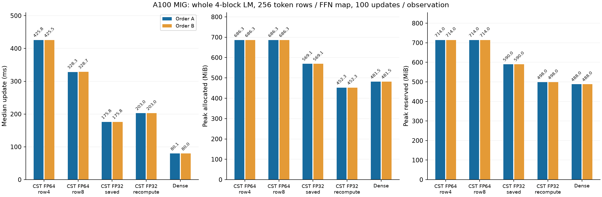
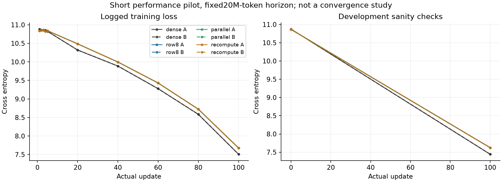

# FP32 multirow intermediates and row-parallel Atom gradients

**English** | [日本語](multirow-packed-20261107.ja.md)

The preceding row8 pilot reduced update time by 22.7% but retained FP64 Z/H/G.
This continuation preserves its mathematical operator, initialization, support,
normalization, detached-radius task VJP and native Polar update. No production
default or unrelated GPU is changed.

Following the user's clarification, the primary candidates use FP32 for
Linear radius/center decode, routing decisions, profile coefficients, phases,
accumulation and moment/response storage. FP64 is the comparison oracle, not a
requirement for the new Linear path. Common host configuration scalars and the
unchanged optimizer are separate from these signal/Linear calculations:

| Algorithm suffix | Retained through backward | Atom-gradient execution |
| --- | --- | --- |
| packed | FP32 Z/H | Original serial row reduction |
| packed_recompute | X/P/keys only; regenerate FP32 Z/H | Eight-row groups plus FP32 partial reduction |
| packed_parallel | FP32 Z/H | Eight-row groups plus FP32 partial reduction |

All use eight-row response projection in addition to the existing eight-row
expansion. The parallel variants evaluate per-Atom geometry once into a small
transient FP32 table, then distribute row groups across CTAs. At R=256/A=4096,
their FP32 geometry/partial scratch is 0.390625/1.5 MiB; these are temporary, not saved
activation arrays. No dense effective W, atom omission or per-tile renormalization
is introduced. Recompute reads forward-time SavedVariables and preserves version
checks, saved-Tensor hooks and first-order differentiation limits.

Scope: 256↔1024 FFN, A4096, FP32, R1..256, Polar modes8/base1/merge2/spacing1,
radius[.5,50]. Four-row and FP64 row8 comparators remain separately selectable.
Generic Tensor/function transforms explicitly fall back to the original path;
no memory/performance claim is made for those fallback modes. Graph is rejected.

Before timing, run metadata/serialization/retention tests, GPU edge/tail tests
and the existing global-native regressions. Test dX-only and Atom-only backward,
repeated backward and mutation rejection. Prove that saved bulk arrays are FP32,
and that recompute variants save no Z/H. Each new Algorithm must pass both full
R=256/A=4096 FFN VJPs against the CPU FP64 Fourier/autograd reference with unchanged
atol3e-5/rtol3e-4 and the independent polynomial-quadrature supplement. Actual
four-block task resume and 3 matched updates versus row8 check gradients,
Parameters and Adam moments/clocks, with exactness reported separately.
The operator VJP and task-gradient tolerance remains atol=3e-5/rtol=3e-4;
Adam moments retain atol=3e-7/rtol=3e-5. The original three-update Parameter gate
(atol=3e-6/rtol=3e-5), and a subsequent atol=1e-5 check, rejected small differences
after Adam updates. Both failures are preserved. After explicit user acceptance
of FP32 differences, the Parameter comparison uses the same atol=3e-5/rtol=3e-4
as the FP32 operator, fixed before performance measurement. This is a disclosed
admission-policy revision, not a claim that the original gates passed. The
independent operator checks, all-gradient comparisons and optimizer moment/clock
gates were not relaxed.

Use the unchanged cst-research FFN learner and previous TinyStories token/data
order. A100 80GB PCIe MIG 3g.40gb only, TF32 off, width 256 / 4 blocks / 4 heads / FFN 4N,
batch 2 × context 128 (R=256), accumulation 4, seed 17, c=8/A=4096, q=0, minimum-001,
Atom LR 16×, base LR 3e-4, AdamW(.9,.95)/decay0/clip1/native finite_chord update,
fixed 20M-token LR/data horizon. Compare baseline4, row8, Dense and all three new
variants in fresh 20-update screens. Screen timings use existing updates 11–20;
all 20 updates enter allocated/reserved peaks. These are candidate selection,
not adoption measurements or convergence runs.

The no-recompute FP32 parallel path is the primary candidate. Recompute remains
an optional time/memory tradeoff, not an assumed requirement. After numerical
gates, screen all variants and confirm the fastest no-recompute candidate AND
the recompute option against baseline4, row8 and Dense in fresh 100-update runs
in two reversed orders (A: baseline4,row8,Dense,primary,recompute;
B: recompute,primary,Dense,row8,baseline4). If a variant fails its numerical
gate, preserve the failure and do not time it. Existing
learner medians use updates 11–100; all 100 updates enter memory. Setup, external
qualification/cold compilation, evaluation, checkpoint/probes remain separate.
No process-memory or Graph claim. Use identical initial CST Parameters and
calibration reports, record loss sanity checks, exact source/result hashes and
all independent process observations. One allocation is not hardware replication.
Stop a frozen attempt on numerical failure/nonfinite/OOM/time budget; preserve
all failures. Any tolerance-policy revision must be explicit and preserved. Raw evidence remains ignored output.

The protocol above precedes the completed evidence below.

## Completed A100 result

**FP32 saved execution reduced complete-update time by 58.68–58.72% versus
row4 and 46.47–46.51% versus row8. Peak allocated memory fell from 686.281 to
569.064 MiB.** Optional recomputation used 452.330 MiB and took about 15.5%
longer than FP32 saved execution. These are scoped research opt-ins; the public
default remains unchanged.

Here, **R=256 is the number of token rows; model width is also 256**, and each
FFN is 256→1024→256. The model has four pre-LN blocks and eight CST FFN maps.
This small model establishes correctness and the memory/time tradeoff. It does
not establish a large-width advantage over Dense. The next study holds R=256
and targets square Linear widths 8192 and 16384; these are widths, not row counts.

Hardware: A100 80GB PCIe MIG 3g.40gb, CC 8.0; Torch 2.6.0+cu126, CUDA 12.6,
Python 3.12.9. Six fresh 20-update screens selected `parallel`. Five arms
then ran 100 updates in each reversed order: 1,000 confirmation updates plus
120 screen updates. Each confirmed observation has 90 timing samples (updates
11–100); all 100 updates enter allocated/reserved peaks. Data transfer, four
microsteps, forward/loss/backward, clipping and optimizer are timed. zero_grad
and LR assignment precede the clock; setup, qualification/cold builds,
evaluation, checkpoint writes and probes are separate. Two observations in one
allocation are not hardware replication or confidence intervals.

| Implementation | Update ms (A / B) | Allocated MiB (A / B) | Reserved MiB (A / B) | Setup s (A / B) |
| --- | ---: | ---: | ---: | ---: |
| baseline | 425.767 / 425.464 | 686.281 / 686.281 | 714 / 714 | 26.46 / 26.06 |
| row8 | 328.333 / 328.665 | 686.281 / 686.281 | 714 / 714 | 26.66 / 26.20 |
| parallel | 175.769 / 175.796 | 569.064 / 569.064 | 590 / 590 | 26.12 / 26.78 |
| recompute | 203.008 / 203.016 | 452.330 / 452.330 | 498 / 498 | 26.18 / 26.24 |
| dense | 80.116 / 80.048 | 481.501 / 481.501 | 488 / 488 | 1.57 / 1.53 |



Dense remains 2.19–2.20× faster than FP32 saved execution at this small width.
Recomputation's allocated peak is 6.06% below Dense, but its reserved peak is
498 versus 488 MiB for Dense; total GPU process memory was not measured. A lower
allocated peak is not a claim that every memory measure is lower. FP32 saved
execution still has a higher allocated peak than Dense.

The 129 targeted CPU/CUDA tests passed (36 CPU tests and 93 CUDA tests), including
all Atom gradients in both FFN directions, tail rows, one-gradient backward,
saved-Tensor hooks, repeated backward and version rejection. Independent CPU
FP64 Fourier/autograd VJPs at R=256/A=4096 passed the unchanged FP32 operator
tolerance. Primary saved/recompute maximum absolute errors were 9.217e-7 (Y),
1.769e-6 (dX), and 2.352e-5 (dP). The serial FP32 candidate also passed, with
dP maximum 3.789e-5 under the absolute-plus-relative criterion. Independent
polynomial quadrature supplemented the Fourier reference. Actual-model
checkpoint resume had zero maximum Parameter error for every route.

All three FP32 candidates passed three full-task gradient/Parameter/Adam checks
under the disclosed revised Parameter policy. Initial CST Parameters and
calibration reports matched in every observation. Same-kind model/optimizer
Tensor hashes matched across reversed orders. More strongly, saved and
recomputed FP32 execution had identical final model/optimizer Tensor hashes
in both orders; row4 and row8 also matched each other. FP32 versus FP64 states
are not claimed byte-exact. Logged training CE differences were at most
9.537e-7; final development CE was 7.6248801947 for both FP32 routes versus
7.6248802394 for FP64 CST and 7.4445793331 for Dense. This is a 100-update warmup
pilot, not evidence of convergence or Dense/CST quality equivalence.



The private Plans can be selected explicitly on an admitted layer:

```python
from torchcst import FixedSelector, make_algorithm_registry
from torchcst._backends.cuda.algorithms.linear.radius_cell_mass.packed import (
    PACKED_PARALLEL, PACKED_RECOMPUTE,
    RadiusPackedParallelAlgorithm, RadiusPackedRecomputeAlgorithm,
)
registry = make_algorithm_registry()
registry.register(RadiusPackedParallelAlgorithm())
registry.register(RadiusPackedRecomputeAlgorithm())
layer.selector = FixedSelector(PACKED_PARALLEL, registry=registry)
# Optional memory/time tradeoff:
# layer.selector = FixedSelector(PACKED_RECOMPUTE, registry=registry)
```

These are not production registry/default recommendations. Qualification used
the frozen FFN shapes, origin 0, radius/envelope and A=4096 recipe above. Other
widths, GPUs, Graph, mixed precision and transformed fallback paths have no
performance claim here. A model checkpoint stores numerical state, not this
selector; record and reapply the Plan when restoring.

Numeric implementation commit: `6468001d46401a940119b40ab53492abeb4306c5`.
Frozen snapshot `318fe312294a4b6263769419f784807a4740d398` corrects the raw-native
metadata test only. Runtime source/binaries remain immutable attempt02; every
snapshot file except that test matched the runtime. Consumer commit:
`ac64f6db4fdf616870c41fed779e1119ecc5e441`.
Source archive SHA256: `f22c118ce2eaa3f75202438c3c662d1116eaa865b6fcc4455656b3a2011a4285`.
Compact evidence SHA256: `b979eaca9bdfd3982c54502fbbb0cf992d5ca9c9a0b3b85a62bfb9613ce9f82a` (780,220 bytes; 154 original files verified
locally). The archive includes the failed attempts and exact policy revisions:
01 fixed a typed shared-workspace compile error; 02 exposed a stale raw-native
bounds fixture; 03 and 04 failed the original stricter Parameter trajectory
criteria. Attempt05 reuses the already-passed identical-source mathematical
checks by SHA256 and applies the user-authorized FP32 Parameter criterion.
Failed gates are not reported as passes.

Raw source archives, requests, drivers, receipts and retrieved evidence remain
in canonical ignored `output/multirow-packed-20261107-01` through `-05`.
Every exact checkpoint remains in its original A100 arm directory; content
SHA256 and complete Tensor manifests are in the compact evidence. Raw oracle
Y/dX/dP payloads and checkpoint payloads were not downloaded; no independent
local oracle recomputation is claimed. Postflight verified 39 owned controller/
child PIDs inactive, source files unchanged and build-binary hashes recorded.
Those binary hashes are postflight build records, not per-process loaded-library
captures. No 4090, pool jobs or unrelated servers were changed. The local CPU
suite before GPU-only fixture changes passed 2,163 tests with 2,547 skips; GPU
qualification is recorded separately above.

## Large-width follow-up

See the separate [R256 width comparison](large-multirow-20261107.md),
[controlled row-count comparison](multirow-batch-20261108.md),
[large-width recomputation](large-recompute-20261108.md) and
[geometry reuse/windowed recomputation](multirow-geometry-20261108.md).
The first study here times whole small-LM updates; those follow-ups time an
isolated square Linear. Their clocks and workload scopes must remain separate.
